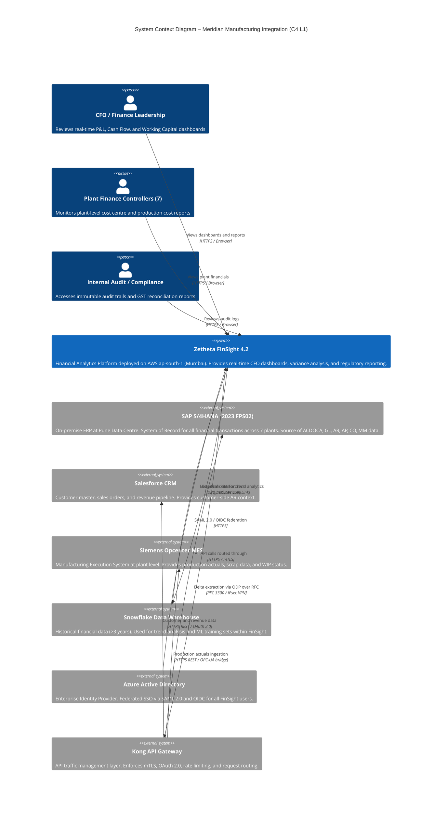
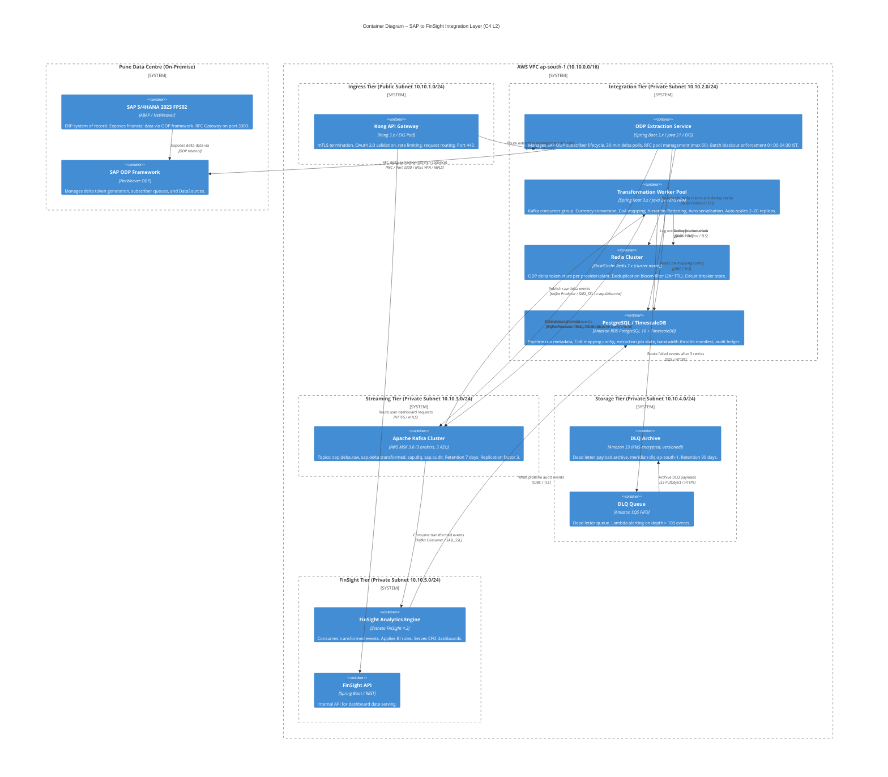
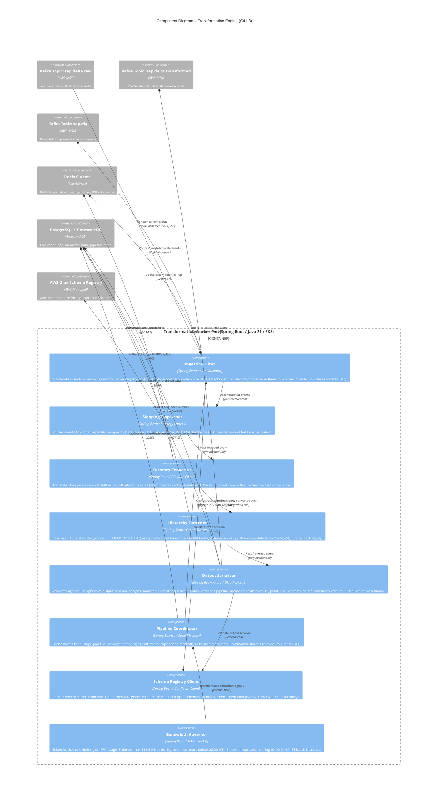
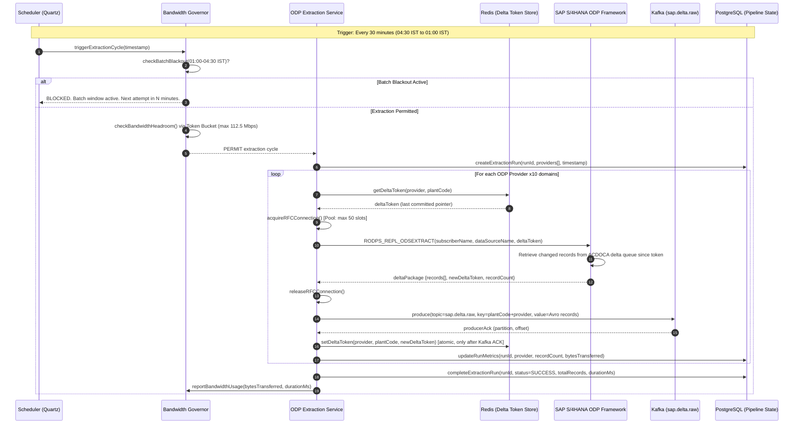
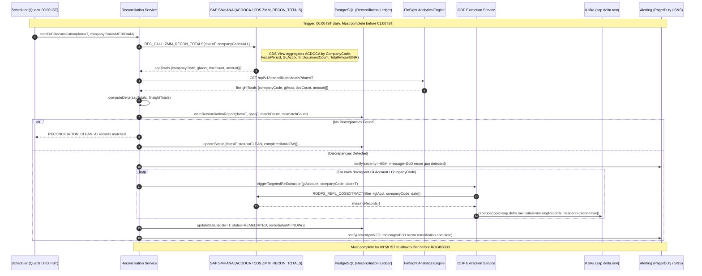
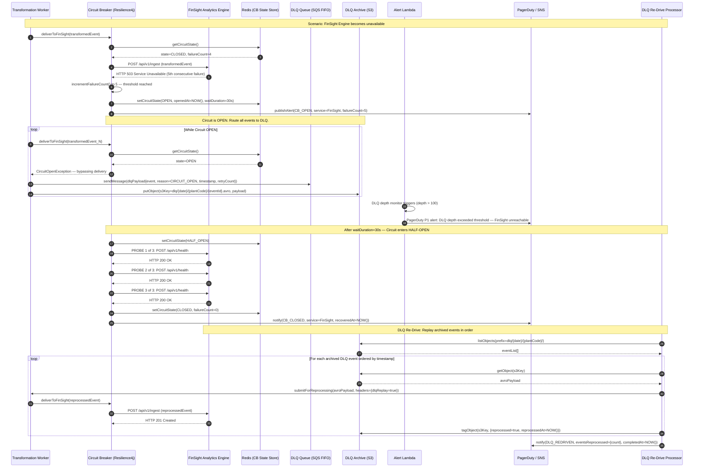

# D1: Integration Architecture Document
## Meridian Manufacturing Ltd. × Zetheta FinSight 4.2

---

| Field | Value |
|---|---|
| **Document ID** | ZA-FDE-D1-MERIDIAN-001 |
| **Version** | 1.0.0 |
| **Classification** | CONFIDENTIAL – CLIENT RESTRICTED |
| **Author** | Zetheta Algorithms – Forward Deployed Engineering (FDE-9B) |
| **Client** | Meridian Manufacturing Ltd. |
| **Prepared For** | Chief Financial Officer / Chief Technology Officer |
| **Date** | 04 October 2026 |
| **Status** | DRAFT FOR REVIEW |

---

> **Legal Notice:** This document contains proprietary and confidential information belonging to Zetheta Algorithms Pvt. Ltd. and Meridian Manufacturing Ltd. Reproduction, distribution, or disclosure to any third party without prior written consent is strictly prohibited. This document is subject to the Non-Disclosure Agreement dated [NDA DATE].

---

## Table of Contents

1. [Executive Summary & System Scope](#1-executive-summary--system-scope)
2. [C4 Architectural Modelling](#2-c4-architectural-modelling)
3. [Network Architecture & Security Topology](#3-network-architecture--security-topology)
4. [Technology Stack Justification Matrix](#4-technology-stack-justification-matrix)
5. [Data Flow & Sequence Diagrams](#5-data-flow--sequence-diagrams)
6. [Risk Register](#6-risk-register)
7. [Appendices](#7-appendices)

---

## 1. Executive Summary & System Scope

### 1.1 Business Problem Statement

Meridian Manufacturing Ltd. (INR 2,400 Cr annual revenue) operates seven manufacturing plants across Maharashtra, Gujarat, and Tamil Nadu, all running on SAP S/4HANA (2023 FPS02) hosted on-premise at the Pune Data Centre. The current financial reporting architecture relies exclusively on SAP nightly batch jobs (principally `RGGBS000`), which generates a **structural 24-hour reporting latency** — meaning the CFO and senior finance leadership make capital allocation, treasury positioning, and working-capital decisions based on data that is, on average, 18–24 hours stale.

This latency creates the following measurable business risks:

| Business Risk | Estimated Exposure |
|---|---|
| Sub-optimal short-term treasury deployment | INR 8–12 Cr/month opportunity cost |
| Delayed detection of plant-level cost overruns | 24–48 hr detection lag across 7 plants |
| GST reconciliation mismatches (Section 194 TDS) | Manual rework: ~1,200 person-hours/quarter |
| Intercompany elimination errors (month-end close) | 3–5 day close cycle delay |
| Working capital mis-estimation (AR/AP intraday) | INR 40–60 Cr intraday exposure window |

**Zetheta's Solution:** Deploy Zetheta FinSight 4.2 Financial Analytics on AWS Asia Pacific Mumbai (`ap-south-1`) with a real-time, ODP-driven integration layer that reduces financial data latency from **24 hours to ≤ 30 minutes** during business hours, while respecting all infrastructure, regulatory, and operational constraints.

### 1.2 Strategic Objectives

1. **Real-Time CFO Visibility:** Enable sub-30-minute financial dashboards spanning P&L, Cash Flow, and COGS across all seven plants.
2. **Regulatory Compliance:** Maintain strict RBI Data Localisation (all data must reside within Indian territory — AWS `ap-south-1` Mumbai), Section 194 TDS integrity, and GST audit trail completeness.
3. **Zero Disruption to SAP Operations:** The integration layer must be non-intrusive, consuming no more than 25% of available MPLS bandwidth (≤ 112.5 Mbps) during business hours and generating zero load during the `RGGBS000` batch window (01:00–04:30 IST).
4. **High Availability & Resilience:** 99.9% SLA on the integration pipeline with automated failover, circuit breaker patterns, and Dead Letter Queue (DLQ) recovery.
5. **Auditability:** Full end-to-end audit trail with immutable event logs for regulatory examination.

### 1.3 Core Functional Scope

The integration covers ten (10) financial and operational domains:

| # | Domain | SAP Source Object | ODP Provider | FinSight Target |
|---|---|---|---|---|
| **1** | **General Ledger (FI-GL)** | Universal Journal `ACDOCA` | `0FI_GL_14` / CDS View `I_JournalEntry` | P&L, BS, Trial Balance |
| **2** | **Accounts Receivable (FI-AR)** | `BSID`, `BSAD`, `KNA1` | `0FI_AR_4` | AR Aging, DSO Analytics |
| **3** | **Accounts Payable (FI-AP)** | `BSIK`, `BSAK`, `LFA1` | `0FI_AP_4` | AP Aging, DPO Analytics |
| **4** | **Cost Centre Accounting (CO-CCA)** | `ACDOCA` (cost element line items) | `0CO_CCA_3` | Plant Cost Dashboards |
| **5** | **Profit Centre Accounting (CO-PCA)** | `ACDOCP` | `0EC_PCA_3` | Segment P&L |
| **6** | **Materials Management (MM-IV)** | `MSEG`, `MKPF`, `MBEW` | `0IC_C03` | Inventory Valuation, COGS |
| **7** | **Production Orders (PP-CO)** | `AUFK`, `AFKO`, `COSS` | `0PP_C_ORD_2` | Production Cost Variance |
| **8** | **Asset Accounting (FI-AA)** | `ANLA`, `ANLC`, `ANEK` | `0FI_AA_11` | Depreciation, NetBlock |
| **9** | **GST / Indirect Tax** | `J_1IG*` tables, `BSET` | Custom CDS `ZMM_GST_DELTA` | GST Reconciliation |
| **10** | **Intercompany / Eliminations** | `ACDOCA` (IC flag), `FBICRC` | `0FI_GL_14` (IC filter) | Consolidated Financials |

### 1.4 Key Infrastructure Constraints Summary

| Constraint | Specification | Integration Impact |
|---|---|---|
| Network Link | 450 Mbps MPLS + SD-WAN | Cap extractions to ≤ 112.5 Mbps (25%) |
| Batch Blackout | 01:00–04:30 IST (`RGGBS000`) | All pipelines suspended in this window |
| RFC Pool | Max 50 concurrent connections (7 plants) | Pool-managed RFC allocation (≤7/plant) |
| ODP Polling | Min 30-minute interval per provider | Micro-batch cadence = exactly 30 min |
| Data Residency | RBI: India-only | AWS `ap-south-1` (Mumbai) exclusively |

---

## 2. C4 Architectural Modelling

### 2.1 C4 Level 1 – System Context Diagram

**Description:**

The Level 1 System Context diagram illustrates how Zetheta FinSight 4.2 sits within Meridian Manufacturing's broader enterprise ecosystem. FinSight acts as the **primary financial intelligence consumer**, drawing operational financial data from SAP S/4HANA (the system of record), augmenting it with customer revenue data from Salesforce CRM, production actuals from Siemens Opcenter MES, and long-term historical warehousing from Snowflake Data Warehouse. Identity and access governance flows through Azure Active Directory via SAML 2.0 / OIDC federation. All inbound API traffic to FinSight is mediated through the Kong API Gateway, which enforces rate limiting, OAuth 2.0 token validation, and mTLS termination.

External users — CFO, Plant Finance Controllers, Group Treasury, and Internal Audit — interact exclusively through FinSight's presentation layer. The SAP system itself is never directly accessible from the AWS environment; all communication is mediated through the integration layer described in Level 2.



---

### 2.2 C4 Level 2 – Container Diagram

**Description:**

The Level 2 Container Diagram expands the integration boundary between SAP S/4HANA and Zetheta FinSight 4.2. The integration layer is entirely hosted within AWS `ap-south-1` (Mumbai) inside a dedicated VPC (`10.10.0.0/16`). Connectivity to the on-premise Pune Data Centre is established via an IPsec VPN tunnel over the existing MPLS link.

The core containers and their responsibilities are:

- **Kong API Gateway (EKS Pod):** Single ingress point for all north-south traffic. Performs OAuth 2.0 token introspection, mTLS termination, rate limiting (per-client and global), and routes requests to downstream microservices.

- **ODP Extraction Service (Spring Boot):** Manages the SAP ODP delta extraction lifecycle. Maintains ODP subscriber registrations, manages delta tokens (stored in Redis), enforces the 30-minute polling cadence, and respects the batch blackout window (01:00–04:30 IST). Communicates with SAP via RFC connections from the managed pool.

- **Apache Kafka Cluster (MSK):** Central event streaming backbone. Deployed as AWS Managed Streaming for Apache Kafka (MSK) with 3 brokers across 3 AZs. Key topics: `sap.delta.raw`, `sap.delta.transformed`, `sap.dlq`, `sap.audit`.

- **Spring Boot Transformation Workers (EKS Deployment):** Horizontally scalable consumer group. Applies currency conversion (RBI rate feed), chart-of-accounts mapping, hierarchy flattening, and Avro serialisation.

- **Redis Cluster (ElastiCache):** (1) ODP Delta Token Store; (2) Deduplication Cache — sliding 2-hour TTL bloom-filter keyed on `(document_number + fiscal_year + line_item)`.

- **PostgreSQL / TimescaleDB (RDS):** Operational state store. Stores pipeline run history, extraction job metadata, CoA mapping configurations, circuit breaker state, and bandwidth throttle manifest.

- **DLQ Storage (S3 + SQS):** Events failing after 3 retries route to SQS FIFO Dead Letter Queue, with payload archived to KMS-encrypted S3 (`meridian-dlq-ap-south-1`). Lambda triggers PagerDuty alerts on DLQ depth > 100.



---

### 2.3 C4 Level 3 – Component Diagram: Transformation Engine

**Description:**

The Level 3 Component Diagram zooms into the **Transformation Worker Pod** — the most complex internal container. Each worker is a Spring Boot application on Java 21, deployed on EKS with HPA scaling between 2 and 20 replicas based on Kafka consumer lag (threshold: > 5,000 unprocessed messages).

The Transformation Engine processes every raw ODP delta event through a deterministic five-stage pipeline:

1. **Ingestion Filter:** Validates schema conformance against Schema Registry. Applies plant/company code whitelist rules. Rejects malformed records to DLQ.

2. **Mapping Dispatcher:** Routes each event to the appropriate domain-specific mapper by `DataSource` ID. Performs Chart of Accounts translation (Meridian operational CoA → FinSight analytical CoA) and field normalisation.

3. **Currency Converter:** Translates foreign currency amounts using RBI reference rates (30-min Redis cache). Ensures GST and TDS amounts remain in INR for Section 194 compliance.

4. **Hierarchy Flattener:** Resolves SAP organisational hierarchies (`SETHEADRT`/`SETLEAF`, profit centre hierarchies) into flat FinSight dimension keys, reducing dashboard render latency by an estimated 60–70%.

5. **Output Serializer:** Validates the transformed record against the FinSight Avro output schema (AWS Glue Schema Registry). Assigns monotonically increasing event sequence number, attaches pipeline metadata, and serialises to Avro binary.



---

## 3. Network Architecture & Security Topology

### 3.1 Connectivity Architecture: Pune DC to AWS Mumbai VPC

The network architecture establishes a **zero-trust, end-to-end encrypted** communication channel between the Pune Data Centre and the AWS `ap-south-1` Mumbai VPC. The existing 450 Mbps MPLS link with SD-WAN overlay is the physical transport layer. An IPsec VPN tunnel provides cryptographic isolation.

**Primary Path:** Pune DC → MPLS (450 Mbps, SD-WAN) → IPsec IKEv2 VPN Tunnel → AWS Virtual Private Gateway (`ap-south-1`) → Transit Gateway → Integration VPC (`10.10.0.0/16`)

**Failover Path:** Should the primary MPLS degrade below 50 Mbps, the SD-WAN controller automatically fails over to a secondary 100 Mbps internet broadband link, maintaining the IPsec tunnel via DPD (Dead Peer Detection). The Bandwidth Governor imposes additional throttling (max 15 Mbps, ~15% of secondary link) on this failover path.

#### 3.1.1 IPsec VPN Tunnel Specification

| Parameter | Value |
|---|---|
| **IKE Version** | IKEv2 |
| **IKE Phase 1 Encryption** | AES-256-GCM |
| **IKE Phase 1 Integrity** | SHA-384 (HMAC) |
| **IKE Phase 1 DH Group** | Group 20 (NIST P-384 ECDH) |
| **IKE Phase 1 Lifetime** | 28,800 seconds (8 hours) |
| **IKE Phase 2 (IPsec) Encryption** | AES-256-GCM |
| **IPsec Protocol** | ESP (Encapsulating Security Payload) |
| **IPsec Mode** | Tunnel Mode |
| **IKE Phase 2 Lifetime** | 3,600 seconds (1 hour) |
| **PFS (Perfect Forward Secrecy)** | Enabled (DH Group 20) |
| **Dead Peer Detection** | Enabled (interval: 10s, retry: 3) |
| **NAT-T** | Disabled (dedicated MPLS, no NAT) |
| **Tunnel MTU** | 1,350 bytes (accounting for IPsec overhead) |

#### 3.1.2 VPC Network Topology

```
AWS VPC: 10.10.0.0/16 (ap-south-1, Mumbai)
|
+-- AZ: ap-south-1a
|   +-- Public Subnet:   10.10.1.0/24   [Kong API Gateway, NAT Gateway]
|   +-- Private Subnet:  10.10.2.0/24   [ODP Svc, Transform Workers, Redis, PostgreSQL]
|   +-- Private Subnet:  10.10.3.0/24   [Kafka / MSK Broker 1]
|   +-- Private Subnet:  10.10.4.0/24   [DLQ Storage, S3 VPC Endpoint]
|   +-- Private Subnet:  10.10.5.0/24   [FinSight Engine, FinSight API]
|
+-- AZ: ap-south-1b
|   +-- Private Subnet:  10.10.12.0/24  [Transform Workers replica]
|   +-- Private Subnet:  10.10.13.0/24  [Kafka / MSK Broker 2]
|   +-- Private Subnet:  10.10.15.0/24  [FinSight Engine replica]
|
+-- AZ: ap-south-1c
    +-- Private Subnet:  10.10.22.0/24  [Redis ElastiCache replica]
    +-- Private Subnet:  10.10.23.0/24  [Kafka / MSK Broker 3]
    +-- Private Subnet:  10.10.25.0/24  [RDS PostgreSQL Multi-AZ standby]

On-Premise (Pune DC):
  192.168.10.0/24  [SAP Application Servers]
  192.168.11.0/24  [SAP DB Servers]
  192.168.12.0/24  [Network Infrastructure / SD-WAN CPE]
```

### 3.2 Encryption Specifications

#### 3.2.1 Data In-Transit

| Channel | Protocol | Cipher Suite | Certificate Authority |
|---|---|---|---|
| User → Kong Gateway | TLS 1.3 | `TLS_AES_256_GCM_SHA384` | AWS ACM (public cert) |
| Kong → Internal Services | mTLS 1.3 | `TLS_AES_256_GCM_SHA384` | Internal Private CA (AWS ACM PCA) |
| ODP Service → SAP RFC | TLS 1.3 over IPsec | `TLS_AES_256_GCM_SHA384` | SAP SSL Certificate (STRUST) |
| Kafka Producers/Consumers | SASL_SSL (TLS 1.3) | `TLS_AES_256_GCM_SHA384` | AWS ACM PCA |
| Services → RDS PostgreSQL | TLS 1.3 | `TLS_AES_256_GCM_SHA384` | RDS CA-Bundle |
| Services → ElastiCache Redis | TLS 1.3 | `TLS_AES_128_GCM_SHA256` | AWS Managed |
| Services → S3 | HTTPS / TLS 1.3 | AWS-managed | AWS ACM |

> **Note:** TLS 1.0 and TLS 1.1 are explicitly disabled across all endpoints. TLS 1.2 is permitted only for legacy SAP components that cannot support TLS 1.3, with a mandatory upgrade path within 6 months of go-live.

#### 3.2.2 Data At-Rest

| Storage Layer | Encryption Standard | Key Management |
|---|---|---|
| S3 (DLQ Archive, Raw Landing) | AES-256 (SSE-KMS) | AWS KMS CMK `meridian-s3-cmk` |
| RDS PostgreSQL | AES-256 (RDS Encryption) | AWS KMS CMK `meridian-rds-cmk` |
| ElastiCache Redis | AES-256 (at-rest) | AWS KMS CMK `meridian-redis-cmk` |
| AWS MSK (Kafka) | AES-256 (EBS encryption) | AWS KMS CMK `meridian-msk-cmk` |
| EKS EBS Volumes (worker pods) | AES-256 | AWS KMS CMK `meridian-eks-cmk` |

**KMS Key Policy Governance:** All CMKs operate under least-privilege IAM policies. Key rotation is enforced annually (automated). Cross-region replication is **disabled** to maintain RBI data localisation. Key usage is logged to AWS CloudTrail.

### 3.3 Firewall Rules & Port Mappings

#### 3.3.1 Ingress Rules (into AWS VPC from Pune DC)

| Rule ID | Source CIDR | Destination | Protocol | Port | Purpose | Action |
|---|---|---|---|---|---|---|
| FW-IN-001 | `192.168.10.0/24` | `10.10.2.0/24` | TCP | 443 | SAP RFC over HTTPS (encrypted channel) | ALLOW |
| FW-IN-002 | `192.168.10.0/24` | `10.10.2.0/24` | TCP | 3300 | SAP RFC Gateway (primary RFC port) | ALLOW |
| FW-IN-003 | `192.168.10.0/24` | `10.10.2.0/24` | TCP | 3600 | SAP Message Server (RFC load balancing) | ALLOW |
| FW-IN-004 | `0.0.0.0/0` | `10.10.1.0/24` | TCP | 443 | User HTTPS to Kong Gateway | ALLOW |
| FW-IN-005 | `192.168.12.0/24` | `10.10.0.0/16` | UDP | 500, 4500 | IKEv2 VPN tunnel negotiation | ALLOW |
| FW-IN-006 | `192.168.12.0/24` | `10.10.0.0/16` | ESP | — | IPsec ESP encapsulated traffic | ALLOW |
| FW-IN-007 | `*` | `10.10.0.0/16` | TCP | 22 | SSH — **DENY ALL** (Bastion via SSM only) | DENY |

#### 3.3.2 Egress Rules (out of AWS VPC to Pune DC)

| Rule ID | Source CIDR | Destination CIDR | Protocol | Port | Purpose | Action |
|---|---|---|---|---|---|---|
| FW-EG-001 | `10.10.2.0/24` | `192.168.10.0/24` | TCP | 3300 | RFC connections to SAP (ODP Service) | ALLOW |
| FW-EG-002 | `10.10.2.0/24` | `192.168.10.0/24` | TCP | 443 | HTTPS health checks to SAP | ALLOW |
| FW-EG-003 | `10.10.0.0/16` | `0.0.0.0/0` | TCP | 443 | AWS service API calls (India, via VPC endpoints) | ALLOW |
| FW-EG-004 | `10.10.0.0/16` | NON-INDIA | TCP/UDP | ALL | **Data egress to non-Indian territory — DENY ALL** | **DENY** |

> **RBI Compliance Note (FW-EG-004):** AWS VPC Endpoint policies and SCPs at the AWS Organisation level are configured to prevent any data from being stored in or transmitted to regions outside `ap-south-1`. Enforced at three layers: (1) Network ACL / Security Group rules; (2) AWS SCP denying actions on non-`ap-south-1` resources; (3) Kong Gateway geo-restriction plugin.

#### 3.3.3 Internal Security Group Rules (East-West within VPC)

| Security Group | Allowed Inbound From | Port | Protocol |
|---|---|---|---|
| `sg-kong-gateway` | `0.0.0.0/0` (internet) | 443 | TCP |
| `sg-integration-services` | `sg-kong-gateway` | 8080 | TCP |
| `sg-kafka-msk` | `sg-integration-services` | 9096 (SASL_SSL) | TCP |
| `sg-redis-cache` | `sg-integration-services` | 6380 (TLS) | TCP |
| `sg-rds-postgres` | `sg-integration-services` | 5432 | TCP |
| `sg-finsight` | `sg-kafka-msk`, `sg-kong-gateway` | 8080, 9096 | TCP |
| `sg-dlq-lambda` | `sg-integration-services` | SQS trigger | — |

---

## 4. Technology Stack Justification Matrix

### 4.1 Message Broker Selection: Apache Kafka vs. Alternatives

#### Decision: Apache Kafka (AWS MSK 3.6)

The integration requires a **durable, high-throughput, replayable event streaming platform** capable of handling peak financial transaction volumes across 7 plants, while supporting exactly-once semantics, 7-day event replay for audit reconciliation, and consumer group isolation.

| Criterion | Apache Kafka (AWS MSK) SELECTED | RabbitMQ | AWS SQS / SNS |
|---|---|---|---|
| **Throughput** | **1M+ msgs/sec** (3-broker MSK, `m5.2xlarge`) | ~50K msgs/sec (clustered) | ~3,000 msgs/sec (standard) / 300 TPS (FIFO) |
| **End-to-End Latency (P99)** | **< 20 ms** (local MSK, same VPC) | < 10 ms (single node) | 50–150 ms (SQS standard) |
| **Message Retention / Replay** | **7 days** (configurable, persistent log) | Not supported (queue drain) | 14 days (SQS) — no replay |
| **Consumer Group Isolation** | **Native** (independent offsets per group) | Exchange + binding (complex) | Separate queues per consumer |
| **Exactly-Once Semantics** | **Yes** (idempotent producer + transactional API) | Requires manual dedup | SQS FIFO: at-least-once effectively |
| **Schema Evolution Support** | **Native** (Glue Schema Registry / Avro) | Plugin-based | Not native |
| **AWS Managed Service** | **Yes** (MSK — fully managed) | Amazon MQ (limited) | Yes (native AWS) |
| **Ordering Guarantee** | **Per partition** (plant-level partitioning) | Per queue | FIFO: per message group |
| **Monthly Licensing Cost (est.)** | **~INR 1.8L/month** (MSK `m5.2xlarge` × 3) | ~INR 0.8L (Amazon MQ) | ~INR 0.4L (volume pricing) |
| **FDE Operational Overhead** | **Low** (MSK fully managed) | Medium (broker tuning) | Very Low (serverless) |
| **Fit for Audit Replay** | **Excellent** (immutable log, offset replay) | Poor | Acceptable (limited) |

**Rejection Rationale:**
- **RabbitMQ:** Lacks native event replay (critical for month-end reconciliation re-runs and audit requirements). AMQP model does not align with log-compaction requirements for delta token tracking. Throughput ceiling insufficient for peak GST period volumes.
- **AWS SQS/SNS:** SQS FIFO's 300 TPS hard limit is a blocking constraint for peak posting periods (estimated 800–1,200 msgs/sec during month-end close). No native replay capability makes audit trail requirements unachievable without external storage.

---

### 4.2 Transformation Engine Selection: Spring Boot / Java 21 vs. Alternatives

#### Decision: Spring Boot 3.x / Java 21 (Virtual Threads)

| Criterion | Spring Boot / Java 21 SELECTED | Python FastAPI | MuleSoft ESB |
|---|---|---|---|
| **Peak Throughput** | **850K+ records/sec** (virtual threads, ZGC) | ~120K records/sec (async I/O, GIL) | ~80K records/sec (Mule runtime) |
| **Latency (Transform P95)** | **< 8 ms per record** | ~15 ms per record | ~25 ms per record |
| **SAP Java Connector (JCo)** | **Native** (SAP JCo 3.x, officially supported) | Requires PyRFC (unofficial) | Native (Mule SAP connector) |
| **Kafka Client Maturity** | **Production-grade** (Spring Kafka, Kafka Streams) | Confluent Python client (adequate) | Kafka connector (mature) |
| **Avro / Schema Registry** | **Excellent** (Spring Kafka + Confluent Avro) | Fastavro (adequate) | Native (Anypoint) |
| **Horizontal Scaling (EKS HPA)** | **Excellent** (container-native, JVM ergonomics) | Good (lightweight containers) | Limited (Mule licence per runtime) |
| **Type Safety & Correctness** | **Strong** (Java type system, compile-time checks) | Dynamic typing (runtime errors possible) | Visual/XML config (error-prone) |
| **Java 21 Virtual Threads** | **Yes** — eliminates thread-per-connection cost | N/A | Not applicable |
| **Zetheta Standard Stack** | **Yes** (existing FDE expertise) | Limited FDE expertise | Available (expensive) |
| **Annual Licensing Cost** | **INR 0** (open source + AWS compute) | INR 0 (open source) | **INR 85–120L/year** (Platinum) |
| **FDE Operational Overhead** | **Low** (familiar stack, mature tooling) | Medium | **High** (MuleSoft-specific skills) |

**Java 21 Virtual Threads Advantage:** The ODP extraction workload is inherently I/O-bound (RFC network calls to SAP). Java 21 virtual threads (Project Loom) allow 10,000+ concurrent I/O operations without OS thread memory overhead, directly enabling efficient RFC pool utilisation within the 50-connection limit.

**Rejection Rationale:**
- **Python FastAPI:** PyRFC lacks SAP's official certification and enterprise support — a risk given Meridian's regulatory obligations. GIL introduces throughput ceilings under CPU-bound workloads. Zetheta FDE does not maintain a Python-based SAP integration reference architecture.
- **MuleSoft ESB:** Licensing cost (INR 85–120L/year) is an unacceptable TCO overhead. Mule runtime licensing bottleneck is fundamentally incompatible with the EKS HPA auto-scaling design.

---

### 4.3 Operational Database Selection: PostgreSQL/TimescaleDB vs. MongoDB

#### Decision: PostgreSQL 16 with TimescaleDB Extension (Amazon RDS)

| Criterion | PostgreSQL 16 / TimescaleDB SELECTED | MongoDB Atlas |
|---|---|---|
| **ACID Compliance** | **Full ACID** (row-level locking, MVCC) | Document-level ACID (4.x+, weaker) |
| **Pipeline Metadata Queries** | **Excellent** (complex joins on run history) | Poor (denormalization required) |
| **Time-Series Metrics (TimescaleDB)** | **Native** (hypertable partitioning, continuous aggregates) | Requires separate time-series handling |
| **CoA Mapping Storage** | **Relational model — exact fit** (normalised, FK constraints) | Schema-less — no referential integrity |
| **Sequence / Auto-Increment** | **Native** (PostgreSQL sequences, monotonic) | Requires application-level sequence |
| **JSON/JSONB Support** | **Excellent** (JSONB with GIN indexes) | Native (document model) |
| **RDS Multi-AZ Availability** | **Yes** (native RDS Multi-AZ, < 60s failover) | Atlas M30+ (more expensive) |
| **Data Sovereignty** | **Full** (RDS in `ap-south-1`) | Atlas cluster must be carefully configured |
| **Monthly Cost (Multi-AZ)** | **~INR 0.6L/month** (db.r6g.xlarge Multi-AZ) | **~INR 1.1L/month** (M40 cluster) |
| **FDE Operational Overhead** | **Low** (standard DBA skills, AWS managed) | Medium (MongoDB-specific ops) |

**TimescaleDB Value-Add:** Pipeline execution metrics are stored in TimescaleDB hypertables. Continuous aggregates provide pre-computed hourly/daily summaries, enabling FinSight operations dashboards to render 90-day pipeline performance trends in < 200ms without full table scans.

**Rejection Rationale:** MongoDB's schema-less document model is a liability for this use case. CoA mapping tables, hierarchy reference data, and pipeline run state require strong relational constraints (foreign keys, transactions) to prevent data corruption. PostgreSQL's ACID guarantees and native RDS Multi-AZ make it the architecturally superior choice at a lower cost.

---

### 4.4 Consolidated Technology Stack Summary

| Layer | Technology | Version | Deployment |
|---|---|---|---|
| API Gateway | Kong Gateway | 3.x | EKS (Kong Ingress Controller) |
| Extraction Service | Spring Boot + SAP JCo | 3.x / JCo 3.1.9 | EKS Deployment |
| Message Broker | Apache Kafka | AWS MSK 3.6 | Managed (3 brokers, `m5.2xlarge`) |
| Transformation Engine | Spring Boot / Java 21 | 3.x / JDK 21 LTS | EKS (HPA: 2–20 replicas) |
| Cache / Dedup | Redis 7.x | Cluster Mode | ElastiCache (`cache.r7g.xlarge`) |
| Operational DB | PostgreSQL 16 + TimescaleDB | PG 16 / TS 2.x | RDS Multi-AZ (`db.r6g.xlarge`) |
| DLQ Queue | Amazon SQS FIFO | Managed | AWS Managed |
| DLQ Archive | Amazon S3 | — | `ap-south-1`, KMS-encrypted |
| Container Orchestration | Amazon EKS | 1.30 | Managed Node Groups |
| Identity | Azure AD (federated) | — | SAML 2.0 / OIDC |
| Secrets Management | AWS Secrets Manager | — | Rotation: 30-day |
| Schema Registry | AWS Glue Schema Registry | — | `ap-south-1` |
| Observability | Amazon CloudWatch + Grafana | — | Managed |
| CI/CD | AWS CodePipeline + CodeBuild | — | GitOps / ArgoCD |

---

## 5. Data Flow & Sequence Diagrams

### 5.1 Flow 1: Real-Time ODP Delta Extraction (30-Minute Micro-Batch)

**Description:**

This flow executes every 30 minutes between 04:30 IST and 01:00 IST. The ODP Extraction Service orchestrates a delta extraction cycle across all 10 ODP providers, managing RFC connection pool allocation to ensure no more than 50 concurrent connections across all plants.

The SAP ODP framework maintains a **delta queue** per subscriber. Each extraction call retrieves only records changed since the last successful delta pointer (delta token), stored in Redis and atomically updated only upon confirmed Kafka offset commit — guaranteeing exactly-once extraction semantics.

**Bandwidth Management:** At 30-minute cadence, typical extraction payload is 15–25 MB per provider per plant. The RFC pool cap (50 connections) enforces serialisation, keeping estimated peak bandwidth to ~60–80 Mbps (well within the 112.5 Mbps cap).



---

### 5.2 Flow 2: End-of-Day Bulk Reconciliation Sync

**Description:**

The EoD Reconciliation Sync executes at **00:00 IST** (before the `RGGBS000` batch window), performing a full checksum reconciliation between cumulative delta extractions processed during the day and authoritative SAP totals from `ACDOCA`. Discrepancies trigger targeted re-extraction of affected records, completing before the 01:00 IST batch blackout.



---

### 5.3 Flow 3: Circuit Breaker Activation and DLQ Routing

**Description:**

The Circuit Breaker pattern (Resilience4j) protects the pipeline from cascading failures when FinSight becomes unavailable. Three states:

- **CLOSED:** Normal operations proceed.
- **OPEN:** After 5 consecutive delivery failures in 60 seconds, the circuit opens. All events route to DLQ for `waitDuration` (30 seconds).
- **HALF-OPEN:** After `waitDuration`, 3 probe requests are sent. If all succeed, circuit returns to CLOSED. If any fail, returns to OPEN.

A DLQ Re-Drive Processor replays archived events from S3 back to `sap.delta.raw` once the destination recovers.



---

## 6. Risk Register

### 6.1 Risk Assessment Methodology

Risk scores are computed as: **Risk Score = Probability Weight × Impact Weight**

| Probability Level | Weight | Impact Level | Weight |
|---|---|---|---|
| High | 3 | High | 3 |
| Medium | 2 | Medium | 2 |
| Low | 1 | Low | 1 |

Score ranges: **Low Risk (1–2)** | **Medium Risk (3–4)** | **High Risk (6–9)**

### 6.2 Risk Register Matrix

| Risk ID | Category | Description | Probability | Impact | Risk Score | Mitigation Strategy | Owner |
|---|---|---|---|---|---|---|---|
| **RSK-001** | Infrastructure | **MPLS Link Degradation / Saturation.** Peak financial period traffic (month-end, GST quarter-end) causes MPLS utilisation to exceed the 25% integration cap (112.5 Mbps), triggering throttling or ODP extraction stalls. Concurrent business application traffic may crowd out integration workloads. | Medium | High | **6** | (1) SD-WAN QoS policy reserves 112.5 Mbps via DSCP marking. (2) Bandwidth Governor enforces hard cap via token bucket. (3) Reduced ODP batch size during peak periods. (4) Secondary broadband failover path pre-tested quarterly. | Meridian IT / Zetheta FDE |
| **RSK-002** | Infrastructure | **RFC Pool Exhaustion.** All 50 RFC connections simultaneously consumed across 7 plants during multi-domain parallel extraction. New requests are queued and the 30-minute ODP cadence is missed, causing data gaps in FinSight. | Medium | Medium | **4** | (1) RFC Pool Manager allocates by priority (GL > AR/AP > CO > MM). (2) Per-plant hard cap of 7 connections. (3) Queue-and-retry within 30-min window. (4) CloudWatch alert at 80% pool utilisation. (5) Request SAP Basis to increase pool to 75 if utilisation persistently exceeds 70%. | Meridian SAP Basis / Zetheta FDE |
| **RSK-003** | Data Quality | **ODP Delta Token Corruption / Loss.** Redis node failure causes delta token loss for one or more ODP providers. Recovery without delta token requires full data load, risking bandwidth breach and batch window conflict, or permanently missing transactions from FinSight. | Low | High | **3** | (1) Redis ElastiCache cluster mode with AOF persistence (`appendfsync always`) to disk-backed EBS. (2) Delta tokens additionally persisted to PostgreSQL after each Kafka offset commit. (3) Automated recovery: on startup, compare Redis token with PostgreSQL backup and promote the more recent valid token. (4) Full-load fallback procedure documented and tested quarterly. | Zetheta FDE / Infrastructure |
| **RSK-004** | Security | **SAP RFC Credential Compromise.** Credentials for the dedicated RFC user `Z_FINSIGHT_ODP` are intercepted or leaked. Attacker could extract `ACDOCA` financial data or invoke unauthorised function modules, constituting a material breach and RBI regulatory violation. | Low | High | **3** | (1) RFC credentials stored exclusively in AWS Secrets Manager — never in config files or environment variables. (2) Automatic 30-day credential rotation. (3) RFC user restricted to minimum authorisation profile (`S_ODP_*` only — no `S_TCODE`, no dialog logon). (4) SAP Security Audit Log (SM20) monitors all RFC logon events. (5) mTLS prevents credential interception in transit. | Meridian SAP Security / Zetheta Security |
| **RSK-005** | Compliance | **RBI Data Localisation Breach.** A misconfigured AWS service (e.g., accidental S3 cross-region replication, non-Indian CloudFront edge) causes financial data to egress outside `ap-south-1`, triggering an RBI violation with potential INR 5–50 Cr penalty. | Low | High | **3** | (1) AWS SCP at Organisation level: explicit DENY on resource creation in non-`ap-south-1` regions. (2) S3 buckets configured with `aws:RequestedRegion` condition policy. (3) AWS Config rules monitor for cross-region replication and non-compliant configurations with a 5-minute alert SLA. (4) Annual third-party RBI compliance audit. (5) VPC Flow Logs analysed daily for egress to non-Indian IP ranges. | Meridian Compliance / Zetheta Architecture |
| **RSK-006** | Data Quality | **GST / Section 194 TDS Integrity Failure.** Currency conversion errors or missed ODP deltas on tax-relevant postings (BSET, J_1IG* tables) cause FinSight to report incorrect GST amounts, leading to erroneous GSTR-1/GSTR-3B filings and potential TDS under-deduction penalties. | Medium | High | **6** | (1) Dedicated GST/TDS validation step: all tax-relevant events flagged `isTaxRelevant=true` and routed through an additional validation rule set. (2) GST amounts always reported in INR (Currency Converter bypassed for INR-denominated tax fields). (3) Nightly GST reconciliation against SAP BSET aggregate (EoD Flow 2 extension). (4) Section 194 TDS cross-referenced against `QBEW` table. (5) GST recon discrepancy blocks month-end close in FinSight until resolved. | Meridian Tax / Zetheta FDE |
| **RSK-007** | Performance | **Kafka Consumer Lag During Month-End Close.** Month-end close increases SAP posting volume 4–6× normal. Kafka `sap.delta.raw` accumulates lag > 50,000 messages. Transformation Workers cannot scale fast enough, causing FinSight to reflect stale data beyond the 30-minute SLA. | Medium | Medium | **4** | (1) EKS HPA scales workers 2 → 20 replicas on consumer lag > 5,000 events (custom Kafka lag metric via KEDA). (2) Month-end pre-scaling event: 8 replicas minimum from T-2 days. (3) Kafka partitions increased from 30 → 60 for month-end window (automated via Kafka Admin API). (4) CloudWatch alarm on lag > 10,000 → PagerDuty P2. (5) FinSight dashboards show data freshness indicator during high-lag periods. | Zetheta FDE / Meridian IT |
| **RSK-008** | Infrastructure | **AWS ap-south-1 Availability Zone Outage.** A single AZ outage takes down one MSK broker, one Redis node, and/or one RDS instance. While Multi-AZ design provides resilience, failover events may cause a 30–120 second disruption and temporary data gaps. | Low | Medium | **2** | (1) All critical components deployed Multi-AZ: MSK (3 brokers, 3 AZs), ElastiCache (Multi-AZ, auto-failover), RDS (Multi-AZ standby). (2) EKS worker nodes spread across 3 AZs with Pod Anti-Affinity rules. (3) Kafka replication factor = 3, `min.insync.replicas = 2` — tolerates 1 broker loss without data loss. (4) RPO = 0, RTO < 120 seconds. (5) Monthly AZ-failover fire drills in staging. | Zetheta Infrastructure |
| **RSK-009** | Data Quality | **SAP Schema Change Breaking ODP Extractors.** SAP S/4HANA SP/FPS upgrades modify CDS view definitions or ODP DataSource field lists, silently breaking Avro schema compatibility and halting the pipeline — potentially undetected until CFO dashboards raise the alert. | Medium | Medium | **4** | (1) Schema Registry set to `BACKWARD_TRANSITIVE` compatibility — new schemas must be backward-compatible. (2) SAP Transport governance: changes to CDS views affecting ODP extractors require integration team sign-off before Production transport. (3) SAP QAS environment mirrors PRD — all schema changes tested in QAS integration environment first. (4) Automated schema diff comparison runs post-SAP SP upgrade in QAS. (5) Canary deployment of new Avro schemas before full production rollout. | Meridian SAP Basis / Zetheta FDE |
| **RSK-010** | Compliance | **Intercompany Elimination Failure at Consolidation.** ODP delta extraction sequence issues (IC payable delta arriving before IC receivable delta) cause FinSight's consolidated P&L to temporarily reflect un-eliminated intercompany transactions. CFO dashboards consumed during this window reflect incorrect consolidated figures. | Medium | High | **6** | (1) IC transactions tagged `isIntercompany=true` from `ACDOCA.RASSC` field. (2) Dedicated `sap.intercompany` Kafka topic with strict ordering (single partition, keyed on IC partner pair). (3) Transformation Engine IC pairing buffer: holds IC receivable until matching IC payable arrives (max hold 5 minutes, then alert). (4) FinSight consolidated views apply real-time IC elimination with explicit `reconciledAt` timestamp. (5) Unmatched IC pairs trigger automated alert to Group Consolidation before dashboard display. | Meridian Group Finance / Zetheta FDE |

---

## 7. Appendices

### Appendix A: SAP ODP Technical Reference

#### A.1 ODP Delta Extraction Mechanism

SAP Operational Data Provisioning (ODP) is the strategic SAP extraction framework introduced with SAP NetWeaver 7.4 and fully integrated into S/4HANA. It supersedes direct BAPI/RFC table reads and `BSEG` full scans by providing a **managed delta queue** mechanism.

| ODP Concept | Description |
|---|---|
| **Subscriber** | A named registration of an external system (e.g., `ZETHETA_FINSIGHT`) against an ODP provider. Created programmatically via RFC `RODPS_REPL_SUBSCRIBE`. |
| **Delta Token** | An opaque pointer (internally a timestamp + change log sequence number) maintained per subscriber per DataSource. Represents the watermark of last-consumed data. |
| **DataSource** | The named ODP provider (e.g., `0FI_GL_14`, `0FI_AR_4`). Defines field list, delta-relevant fields, and extraction modes (Full / Delta Init / Delta). |
| **Delta Queue** | SAP maintains a persistent queue of changed records per subscriber. Records are retained until the subscriber acknowledges consumption via delta token advance. |
| **ACDOCA** | The Universal Journal table in S/4HANA — single source of truth for all accounting line items. All GL, AR, AP, CO, AA postings are stored here. |
| **CDS Views** | Core Data Services views (e.g., `I_JournalEntry`, `I_CustomerLineItem`) provide semantic, optimised access to ACDOCA. They underlie ODP DataSources. |

#### A.2 RFC Function Modules Used

| Function Module | Purpose | Authorisation Object |
|---|---|---|
| `RODPS_REPL_SUBSCRIBE` | Register ODP subscriber | `S_ODP_NOTF` |
| `RODPS_REPL_ODSEXTRACT` | Execute delta extraction | `S_ODP_READ` |
| `RODPS_REPL_ACKNOWLEDGE` | Advance delta token | `S_ODP_NOTF` |
| `RODPS_REPL_UNSUBSCRIBE` | Deregister subscriber | `S_ODP_NOTF` |
| `RFC_READ_TABLE` | EoD reconciliation aggregate read | `S_TABU_DIS` (restricted) |

#### A.3 ODP Polling Schedule

| Time Window | Action | Rationale |
|---|---|---|
| 04:30 – 22:00 IST | 30-min ODP delta cycle (all providers) | Business hours — real-time CFO visibility |
| 22:00 – 00:00 IST | 30-min ODP delta cycle (reduced batch size) | After-hours posting catchup |
| 00:00 – 00:58 IST | EoD Reconciliation Sync only | Pre-batch preparation window |
| 01:00 – 04:30 IST | **ALL EXTRACTION SUSPENDED** | `RGGBS000` batch window protection |

---

### Appendix B: Bandwidth Throttle Calculation

**Given Constraints:**
- Total MPLS Link: 450 Mbps
- Maximum Integration Allocation: 25% = **112.5 Mbps**

**Estimated Extraction Payload per 30-minute Cycle (7 plants combined):**

| ODP Provider | Avg Records/30min | Avg Record Size | Payload/Cycle |
|---|---|---|---|
| `0FI_GL_14` (GL) | 8,500 | 1.2 KB | 10.2 MB |
| `0FI_AR_4` (AR) | 3,200 | 0.9 KB | 2.9 MB |
| `0FI_AP_4` (AP) | 2,800 | 0.9 KB | 2.5 MB |
| `0CO_CCA_3` (CCA) | 4,100 | 0.8 KB | 3.3 MB |
| `0EC_PCA_3` (PCA) | 2,600 | 0.8 KB | 2.1 MB |
| `0IC_C03` (MM) | 5,400 | 1.1 KB | 5.9 MB |
| `0PP_C_ORD_2` (PP) | 3,800 | 1.0 KB | 3.8 MB |
| `0FI_AA_11` (AA) | 800 | 0.7 KB | 0.6 MB |
| `ZMM_GST_DELTA` (GST) | 6,200 | 1.3 KB | 8.1 MB |
| `0FI_GL_14` IC filter | 1,200 | 1.2 KB | 1.4 MB |
| **Total per cycle** | **38,600 records** | — | **~40.8 MB** |

**Average bandwidth (with IPsec overhead ×1.15):**

```
= 40.8 MB × 1.15 ÷ (30 × 60 seconds) × 8 bits/byte
= ~0.21 Mbps average
```

**Peak burst estimate (10× average at month-end):**
```
= ~2.1 Mbps peak burst
```

**Conclusion:** Normal operations consume < 2% of the 112.5 Mbps allocation. At 10× month-end peak, estimated burst is ~21 Mbps — 81% headroom remains. The 112.5 Mbps cap functions as a safety guardrail, not an active operational constraint.

---

### Appendix C: Glossary

| Term | Definition |
|---|---|
| **ACDOCA** | Universal Journal table in SAP S/4HANA — primary source for all accounting data |
| **CDS View** | Core Data Services — SAP's semantic data access layer above database tables |
| **DLQ** | Dead Letter Queue — destination for undeliverable or permanently failed events |
| **FDE** | Forward Deployed Engineer — Zetheta client-embedded technical specialist |
| **HPA** | Horizontal Pod Autoscaler — Kubernetes mechanism for dynamic replica scaling |
| **IKEv2** | Internet Key Exchange version 2 — protocol for IPsec VPN tunnel negotiation |
| **mTLS** | Mutual TLS — both client and server authenticate with certificates |
| **ODP** | Operational Data Provisioning — SAP's strategic delta extraction framework |
| **PFS** | Perfect Forward Secrecy — cryptographic property ensuring session key independence |
| **RFC** | Remote Function Call — SAP's proprietary inter-system communication protocol |
| **RGGBS000** | SAP nightly financial balance carry-forward batch program |
| **SCP** | Service Control Policy — AWS Organizations guardrail policy |
| **SETHEADRT / SETLEAF** | SAP hierarchy tables for set membership (cost centre and profit centre groups) |
| **TCO** | Total Cost of Ownership |
| **TimescaleDB** | PostgreSQL extension optimised for time-series data with hypertable partitioning |
| **VGW** | Virtual Private Gateway — AWS-side termination point for Site-to-Site VPN tunnels |

---

### Appendix D: Document Revision History

| Version | Date | Author | Changes |
|---|---|---|---|
| 0.1 | 20 Sep 2026 | Zetheta FDE-9B | Initial draft — scope and architecture |
| 0.5 | 28 Sep 2026 | Zetheta FDE-9B | Added security topology, risk register |
| 1.0 | 04 Oct 2026 | Zetheta FDE-9B | Production-ready draft for client review |

---

### Appendix E: Sign-Off & Approval

| Role | Name | Organisation | Signature | Date |
|---|---|---|---|---|
| Forward Deployed Engineer | [FDE Name] | Zetheta Algorithms | _________________ | ________ |
| Solutions Architect | [SA Name] | Zetheta Algorithms | _________________ | ________ |
| Chief Financial Officer | [CFO Name] | Meridian Manufacturing Ltd. | _________________ | ________ |
| Chief Technology Officer | [CTO Name] | Meridian Manufacturing Ltd. | _________________ | ________ |
| SAP Basis Lead | [Name] | Meridian Manufacturing Ltd. | _________________ | ________ |
| IT Security Officer | [Name] | Meridian Manufacturing Ltd. | _________________ | ________ |

---

*Document Classification: CONFIDENTIAL – CLIENT RESTRICTED*
*© 2026 Zetheta Algorithms Pvt. Ltd. All rights reserved.*
*Reference: ZA-FDE-D1-MERIDIAN-001 v1.0.0 | Generated: 04 October 2026*
