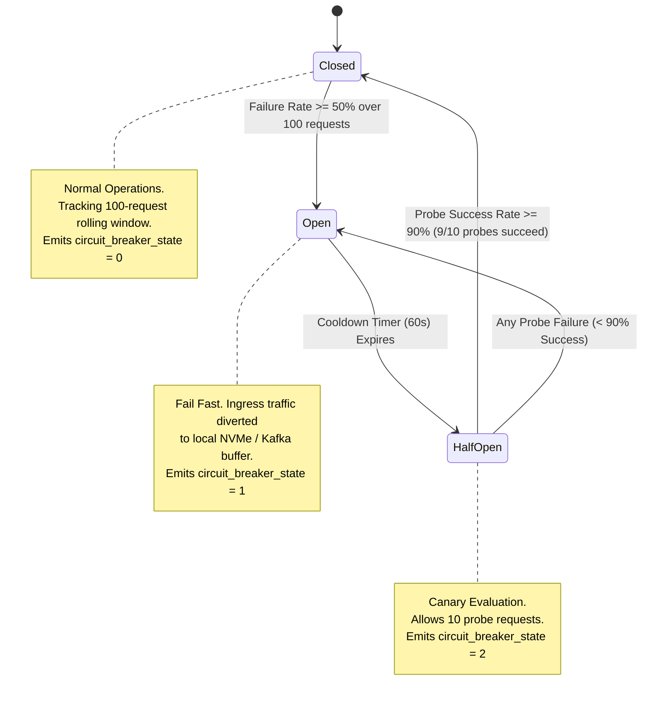
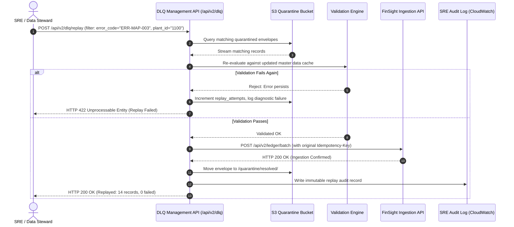

# MERIDIAN MANUFACTURING LTD. | PRODUCTION INTEGRATION BLUEPRINT
## DELIVERABLES D4, D5, & D6: RELIABILITY, RECONCILIATION & OBSERVABILITY FRAMEWORK
**Document Reference:** ZET-MM-D456-PROD-2026-V1  
**Target Architecture:** SAP S/4HANA (2023 FPS02 On-Premise) to Zetheta FinSight 4.2 (AWS ap-south-1)  
**Author:** Principal Site Reliability Engineer (SRE) & Lead Data Integrity Specialist  
**Classification:** Confidential / Enterprise Production Standard  
**Revision Date:** October 2026  
**Status:** Approved for Production Deployment  

---

## EXECUTIVE SUMMARY & ARCHITECTURAL BASELINE

Meridian Manufacturing Ltd. operates 7 manufacturing plants across Maharashtra, Gujarat, and Tamil Nadu, generating INR 2,400 Crore in annual revenue. The integration pipeline synchronizes mission-critical financial, operational, and supply-chain datasets from SAP S/4HANA (Pune On-Premises Data Centre) to Zetheta FinSight 4.2 Financial Analytics platform (AWS ap-south-1, Mumbai).

To guarantee strict compliance with Indian statutory mandates (Companies Act 2013, GST Act, RBI Master Directions on Financial Data Governance) and internal enterprise controls, the integration architecture mandates:
1. **Deliverable D4:** An industrial-grade **Error Handling & Retry Framework** featuring a 4-tier taxonomy, decorrelated exponential backoff with full jitter, three-state circuit breaker protection, and an automated 14-day encrypted Dead Letter Queue (DLQ) with deterministic operational replay.
2. **Deliverable D5:** A mathematically rigorous **Reconciliation & Data Quality (DQ) Framework** enforcing zero-tolerance balance integrity ($\Delta = \pm 0.00\text{ INR}$), 25 production validation rules spanning 6 domains, and automated batch certification reporting.
3. **Deliverable D6:** An enterprise **Monitoring, Observability & Alerting Specification** comprising a 12-panel Grafana dashboard, valid PromQL/LogQL analytics, a 12-attribute structured JSON logging standard, and 15 mission-critical alerting rules paired with automated mitigation runbooks.

---

# PART 1: DELIVERABLE D4 - ERROR HANDLING & RETRY FRAMEWORK

## 1.1 ERROR CLASSIFICATION TAXONOMY

The integration engine standardizes error handling across all ingest, transform, load, and reconciliation stages using four distinct, mutually exclusive error classes. Each class mandates a deterministic recovery policy to protect upstream SAP RFC work processes, maintain MPLS bandwidth thresholds (max 112.5 Mbps during business hours), and prevent ledger state corruption.

```
                                  ┌────────────────────────┐
                                  │    Pipeline Failure    │
                                  └───────────┬────────────┘
                                              │
                      ┌───────────────────────┴───────────────────────┐
                      │                                               │
             [Operational Root]                             [Semantic / Invariant]
                      │                                               │
          ┌───────────┴───────────┐                       ┌───────────┴───────────┐
          │                       │                       │                       │
    ▼     ▼                 ▼     ▼                 ▼     ▼                 ▼     ▼
┌──────────────────┐┌──────────────────┐┌──────────────────┐┌──────────────────┐
│    TRANSIENT     ││      SYSTEM      ││   DATA QUALITY   ││    PERMANENT     │
├──────────────────┤├──────────────────┤├──────────────────┤├──────────────────┤
│• Network Hiccup  ││• Node Out of Mem ││• Unbalanced GL   ││• 401 Unauthorized│
│• 503 / 429 Rate  ││• EBS Disk Full   ││• Bad GSTIN / PAN ││• Schema Drift    │
│• RFC Pool Busy   ││• Kafka Broker Dwn││• Unmapped CostCtr││• 400 Bad Request │
├──────────────────┤├──────────────────┤├──────────────────┤├──────────────────┤
│ ACTION: Retry    ││ ACTION: Failover ││ ACTION: Isolate  ││ ACTION: Halt &   │
│ with Backoff +   ││ Circuit Breaker  ││ to S3 DLQ; Notify││ Reject Payload;  │
│ Jitter; Spillover││ P1/P2 On-Call    ││ Data Stewards    ││ Notify Architect │
└──────────────────┘└──────────────────┘└──────────────────┘└──────────────────┘
```

### Taxonomy Definitions:
1. **TRANSIENT:** Temporary infrastructure anomalies, network micro-partitions over the 450 Mbps MPLS link, transient gateway throttles (HTTP 429), temporary backpressure, or lock contention in SAP S/4HANA (e.g., table `ACDOCA` enqueue locks).  
   *Resolution Policy:* Safe for automated retry using decorrelated jitter backoff. Maximum 4 retry attempts before transitioning to quarantine.
2. **PERMANENT:** Structural defects in the payload, schema violations, invalid HTTP verbs, malformed JSON/Protocol Buffers, missing mandatory cryptographic signatures, or authentication/authorization rejections (HTTP 401/403, SAP `S_RFC` rejection).  
   *Resolution Policy:* Immediate failure. Retries are strictly prohibited as repeated requests will produce identical failures. Route directly to DLQ with fatal diagnostic tags.
3. **DATA QUALITY (DQ):** Business invariant breaches, reference data absence (e.g., Cost Centre unmapped in `CSKS`, missing entry in `TCURR` exchange rate table), or statutory format failures (e.g., invalid Indian GSTIN checksum).  
   *Resolution Policy:* Non-blocking quarantine. The offending document or line item is isolated into the quarantine storage layer while the remaining batch completes. Triggers workflow ticket to Plant Master Data Stewards.
4. **SYSTEM:** Catastrophic underlying platform failures, host OS out-of-memory (OOM) eviction, worker disk exhaustion, AWS KMS envelope decryption failures, or Kafka storage partition degradation.  
   *Resolution Policy:* Immediate circuit breaking, traffic draining, process fencing, and P1 critical alerting to the SRE Command Center.

---

## 1.2 COMPLETE PRODUCTION ERROR CODE REGISTRY

Every pipeline exception is mapped to a standardized alphanumeric code adhering to the syntax: `ERR-[STAGE]-[SEQUENCE]`.

| Error Code | Canonical Name | Class | HTTP/RFC Equivalent | Retryable | Handling Strategy & Escalation |
| :--- | :--- | :--- | :--- | :---: | :--- |
| **ERR-EXT-001** | SAP RFC Pool Exhaustion | TRANSIENT | RFC_COMMUNICATION_FAILURE (RC=1) | YES | Trigger decorrelated backoff. If active connections = 50, pause polling for 15s. Escalate to P3 if sustained > 5 min. |
| **ERR-EXT-002** | ODP Delta Token Sequence Gap | PERMANENT | RODPS_REPL_EXCEPTION (RC=12) | NO | Halt extraction pipeline for target provider. Prevent out-of-order delta ingestion. Trigger SAP ODP delta rebuild runbook. Escalate to Lead Integration Architect (P2). |
| **ERR-EXT-003** | SAP Enqueue Lock Contention | TRANSIENT | RFC_SYSTEM_FAILURE (TABLE_LOCKED) | YES | Retry with jitter up to 4 attempts. Target SAP background lock release (wait for `RGGBS000` window clearance). If unresolved, divert batch to spillover cache. |
| **ERR-EXT-004** | SAP RFC Authorization Rejected | PERMANENT | RFC_NO_AUTHORIZATION (`S_RFC`) | NO | Terminate session immediately. Log failed authorization object and service user ID. Alert Infosec & SAP Basis via P1/P2 ticket. |
| **ERR-MAP-001** | Unmapped Cost/Profit Center | DATA QUALITY | TRANSFORMATION_LOOKUP_FAILURE | NO (To DLQ) | Isolate record to DLQ quarantine. Lookup against `CSKS`/`CEPC` cache failed. Generate master data ticket assigned to Plant Controller. |
| **ERR-MAP-002** | Fiscal Variant V3 Mapping Failure | DATA QUALITY | DATE_OUT_OF_BOUNDS | NO (To DLQ) | Flag invalid posting date `BUDAT` or period `POPER` (outside 01-16). Route to DLQ with payload snapshot. Batch processing continues for valid items. |
| **ERR-MAP-003** | Invalid GSTIN/PAN Checksum | DATA QUALITY | STATUTORY_VALIDATION_ERROR | NO (To DLQ) | Quarantine line item. Validate against GST 15-character alphanumeric regex and mod-36 checksum. Alert Plant Accounts Payable lead. |
| **ERR-MAP-004** | TCURR Missing Exchange Rate | DATA QUALITY | CURRENCY_CONVERSION_ERROR | NO (To DLQ) | Query missing `KURST='M'` rate for posting date. If unavailable, isolate record to DLQ. Do not apply stale rates > 24 hours without audit override. |
| **ERR-MAP-005** | 3-Way Tax Split Mismatch | DATA QUALITY | TAX_CALCULATION_MISMATCH | NO (To DLQ) | Verify $CGST + SGST = IGST$ equivalent. If rounding variance exceeds $\pm 0.05\text{ INR}$, quarantine record and signal tax compliance queue. |
| **ERR-MAP-006** | Schema Cast / Overflow Error | PERMANENT | DATA_TYPE_CONVERSION_EXCEPTION | NO | Drop to DLQ with stack trace. Decimal precision overflow in Decimal(18,2) or invalid string encoding (UTF-8). Notify Data Integration Team. |
| **ERR-LOAD-001**| FinSight API Rate Limited | TRANSIENT | HTTP 429 Too Many Requests | YES | Respect `Retry-After` response header. Apply exponential backoff. Engage worker concurrency throttle (scale down active threads from 16 to 4). |
| **ERR-LOAD-002**| FinSight Gateway Down | TRANSIENT | HTTP 503 Service Unavailable / 504 | YES | Engage Circuit Breaker. Buffer transformed micro-batches in local Kafka buffer. Failover to secondary ingress if downtime > 60s. |
| **ERR-LOAD-003**| FinSight JWT Token Expired | PERMANENT | HTTP 401 Unauthorized / 403 Forbidden | NO (Auto-Refresh) | Invalidate local token cache. Invoke OAuth 2.0 token endpoint using mTLS client credentials. If refresh fails 2x, trip P1 alert. |
| **ERR-LOAD-004**| Malformed Ingestion Payload | PERMANENT | HTTP 400 Bad Request | NO | Reject batch. Write malformed JSON/Protobuf payload directly to S3 Dead Letter bucket. Alert Integration Engineer. |
| **ERR-LOAD-005**| Idempotency Key Conflict | PERMANENT | HTTP 409 Conflict | NO | Verify existing transaction status via `GET /api/v2/ledger/status/{idempotency_key}`. If prior batch committed, mark as SUCCESS (skip duplicate). |
| **ERR-RECON-001**| Dual-Entry GL Balance Breach | DATA QUALITY | FINANCIAL_INTEGRITY_BREACH | NO (HALT) | **CRITICAL P1:** Balance variance $\sum(\text{Debits}) - \sum(\text{Credits}) \neq 0.00\text{ INR}$. Immediate pipeline freeze. Notify Head of Finance & SRE Lead. |
| **ERR-RECON-002**| Batch Count Discrepancy | DATA QUALITY | RECONCILIATION_COUNT_MISMATCH | NO (HALT) | Check equation: $Extracted \neq Loaded + Skipped + Quarantined$. Pause delta commit token. Trigger audit reconciliation scan. |
| **ERR-RECON-003**| Checksum Hash Mismatch | DATA QUALITY | CRYPTOGRAPHIC_INTEGRITY_BREACH | NO (HALT) | Ingested SHA-256 payload digest differs from SAP source hash. Quarantine batch. Guard against in-flight network corruption. |
| **ERR-SYS-001** | Worker Node Resource Saturation | SYSTEM | OS_RESOURCE_EXHAUSTION (OOM/CPU) | NO | Kubernetes liveness/readiness probe failure. Evict pod, spin up replacement on secondary node, auto-scale worker pool via HPA. |
| **ERR-SYS-002** | Kafka Broker / Ingress Partition | SYSTEM | BROKER_UNREACHABLE_EXCEPTION | YES (to Buffer) | Fallback to local NVMe disk buffer queue. Reroute traffic away from degraded AZ in `ap-south-1`. Alert SRE on-call immediately (P1). |

---

## 1.3 RESILIENCE & CIRCUIT BREAKER MECHANICS

### 1.3.1 Decorrelated Exponential Backoff with Jitter
To prevent "thundering herd" spikes against both the on-premise SAP Gateway and the cloud FinSight Ingestion API, all transient retries utilize **Decorrelated Exponential Backoff with Full Jitter**.

#### Mathematical Formulation:
Let $c$ be the maximum wait cap, $b$ the base wait time, and $a$ the current retry attempt ($a \in \{1, 2, 3, 4\}$):
$$\text{wait}_a = \min\left(c, \text{Uniform}\left(b, b \times 2^a\right)\right)$$

Where:
* **Base ($b$):** $2.0\text{ seconds}$
* **Multiplier:** $2.0$
* **Cap ($c$):** $60.0\text{ seconds}$
* **Max Attempts ($N_{max}$):** $4\text{ attempts}$

#### Quantitative Retry Sequence Table:
| Attempt ($a$) | Minimum Wait ($\text{sec}$) | Maximum Wait Calculation | Actual Cap Range ($\text{sec}$) | Expected Mean Wait ($\text{sec}$) | Cumulative Mean Wait ($\text{sec}$) |
| :---: | :---: | :---: | :---: | :---: | :---: |
| **1** | $2.0$ | $2.0 \times 2^1 = 4.0$ | $[2.0, 4.0]$ | $3.0$ | $3.0$ |
| **2** | $2.0$ | $2.0 \times 2^2 = 8.0$ | $[2.0, 8.0]$ | $5.0$ | $8.0$ |
| **3** | $2.0$ | $2.0 \times 2^3 = 16.0$ | $[2.0, 16.0]$ | $9.0$ | $17.0$ |
| **4** | $2.0$ | $2.0 \times 2^4 = 32.0$ | $[2.0, 32.0]$ | $17.0$ | $34.0$ |
| **Exhausted** | - | - | - | - | **Route to DLQ / Raise ERR-LOAD-002** |

#### Implementation Reference (Production Python 3.11):
```python
import random
import time
import logging
from typing import Callable, Any

logger = logging.getLogger("meridian.resilience")

BASE_BACKOFF_SEC = 2.0
CAP_BACKOFF_SEC = 60.0
MAX_ATTEMPTS = 4

def execute_with_jitter_backoff(operation: Callable[[], Any], operation_name: str) -> Any:
    """
    Executes a callable utilizing Decorrelated Exponential Backoff with Jitter.
    Enforces Meridian SRE resilience constraints.
    """
    attempt = 1
    while attempt <= MAX_ATTEMPTS:
        try:
            return operation()
        except TransientException as exc:
            if attempt == MAX_ATTEMPTS:
                logger.error(
                    f"Exhausted all {MAX_ATTEMPTS} attempts for operation '{operation_name}'. "
                    f"Routing to DLQ. Last error: {str(exc)}",
                    extra={"error_code": exc.error_code, "attempt": attempt}
                )
                raise
            
            upper_bound = min(CAP_BACKOFF_SEC, BASE_BACKOFF_SEC * (2 ** attempt))
            sleep_duration = random.uniform(BASE_BACKOFF_SEC, upper_bound)
            
            logger.warning(
                f"Transient failure during '{operation_name}' (attempt {attempt}/{MAX_ATTEMPTS}). "
                f"Backing off for {sleep_duration:.3f}s. Error: {str(exc)}",
                extra={"retry_wait_sec": sleep_duration, "attempt": attempt}
            )
            time.sleep(sleep_duration)
            attempt += 1
```

---

### 1.3.2 Circuit Breaker State Machine

To shield FinSight and SAP Gateway during catastrophic outages, the pipeline wraps all egress clients in a strict three-state Circuit Breaker.



#### Operational State Transition Specifications:
1. **CLOSED (State Code: 0):**
   * All requests pass through to the target service.
   * Execution metrics are tracked in a sliding window of **100 consecutive requests**.
   * *Trip Condition:* If $\ge 50\%$ (50 out of 100) return `TRANSIENT` or `SYSTEM` errors (`ERR-LOAD-001`, `ERR-LOAD-002`, `ERR-EXT-001`, `ERR-SYS-002`), the circuit breaker trips immediately to **OPEN**.
2. **OPEN (State Code: 1):**
   * All outbound requests are intercepted and failed fast without touching the target network interface.
   * Incoming messages from SAP are buffered directly into high-durability Kafka topics (`meridian.backpressure.buffer.v1`) to prevent upstream SAP RFC work process blocking.
   * *Reset Timer:* A hard sleep of **60.0 seconds** is enforced. After 60 seconds, the breaker transitions to **HALF-OPEN**.
3. **HALF-OPEN (State Code: 2):**
   * The breaker permits exactly **10 canary probe requests** through to the target endpoint.
   * *Success Criterion:* If $\ge 90\%$ (at least 9 out of 10) canary probes succeed, the breaker transitions back to **CLOSED**, resets the rolling error window, and restores normal stream processing.
   * *Failure Criterion:* If $> 1$ probe fails ($< 90\%$ success rate), the breaker immediately trips back to **OPEN** for another 60-second cooldown cycle.

---

## 1.4 DEAD LETTER QUEUE (DLQ) ARCHITECTURE & REPLAY PROTOCOL

### 1.4.1 Storage & Retention Architecture
Messages that fail due to `PERMANENT` errors, `DATA QUALITY` violations, or exhausted retries are diverted to the enterprise Dead Letter Queue.

* **Primary Storage:** Dedicated Amazon S3 Bucket: `s3://meridian-prod-dlq-ap-south-1/quarantine/`
* **Encryption Standard:** AWS KMS Customer-Managed Key (CMK) with AES-256 GCM envelope encryption (`arn:aws:kms:ap-south-1:112233445566:key/meridian-dlq-cmk`).
* **Enforced Retention:** **14 Days** active lifecycle in S3 Standard.
* **Archival Lifecycle Rule:** After 14 days, automated S3 Lifecycle transitions unpurged quarantine payloads to **S3 Glacier Flexible Retrieval** for **7 years** to satisfy the mandatory financial audit trail requirements under Section 128 of the Indian Companies Act 2013.
* **Tamper Protection:** S3 Object Lock in **Compliance Mode** enabled; prevents deletion or alteration by any IAM identity, including AWS root.

### 1.4.2 Quarantine Envelope Schema
Every quarantined message is encapsulated in an immutable diagnostic envelope:

```json
{
  "$schema": "https://meridian.com/schemas/dlq-envelope-v1.json",
  "dlq_message_id": "dlq-7a1b-4f9c-9821-20261004110001",
  "correlation_id": "c928e9e2-6a2d-4c44-a17e-734689b552f9",
  "batch_id": "BATCH-20261004-1100-01",
  "plant_id": "1100",
  "source_entity": "ACDOCA",
  "sap_document_id": "0100049281",
  "fiscal_year": "2026",
  "error_code": "ERR-MAP-003",
  "error_class": "DATA_QUALITY",
  "error_description": "GSTIN checksum verification failed: 27AABCM8892A1Z1 mismatch for Plant 1100",
  "quarantine_timestamp": "2026-10-04T06:38:12.412Z",
  "retry_count": 4,
  "payload_sha256": "e3b0c44298fc1c149afbf4c8996fb92427ae41e4649b934ca495991b7852b855",
  "remediation_status": "PENDING_REVIEW",
  "raw_payload": {
    "RCLNT": "100",
    "RLDNR": "0L",
    "RBUKRS": "1000",
    "GJAHR": "2026",
    "BELNR": "0100049281",
    "DOCLN": "000001",
    "PRCTR": "PC1100",
    "KOSTL": "CC1100-ENG",
    "BUDAT": "20261004",
    "BLDAT": "20261004",
    "WAERS": "INR",
    "HSL": 482500.00,
    "SHKZG": "S",
    "GSTIN": "27AABCM8892A1Z1"
  }
}
```

### 1.4.3 Operational Replay Protocol & Management APIs

To eliminate manual database tampering, the SRE team operates an automated, idempotent Replay Engine exposed via secure REST endpoints requiring role `ROLE_MERIDIAN_SRE_ADMIN`.



#### DLQ API Endpoints:
* `GET /api/v2/dlq/messages`: Query quarantine backlog. Supports filters: `plant_id`, `error_code`, `date_from`, `date_to`, `status`.
* `GET /api/v2/dlq/messages/{dlq_message_id}`: Fetch complete diagnostic envelope and raw payload.
* `POST /api/v2/dlq/replay`: Execute automated batch replay. Payload parameters:
  ```json
  {
    "filter": {
      "plant_id": "1100",
      "error_code": "ERR-MAP-003",
      "quarantine_date": "2026-10-04"
    },
    "dry_run": false,
    "force_revalidation": true,
    "audit_justification": "GSTIN master table updated with correct state registration code for Pune Chakan Plant."
  }
  ```
* `PATCH /api/v2/dlq/messages/{dlq_message_id}`: Apply certified in-flight mutation (requires two-man rule digital signature from Plant Controller and SRE).

---

# PART 2: DELIVERABLE D5 - RECONCILIATION LOGIC & DATA QUALITY FRAMEWORK

## 2.1 FOUR DIMENSIONS OF FINANCIAL RECONCILIATION

Financial data integrity is absolute. Under Meridian's accounting governance, financial discrepancies are never written off or averaged out. The system continuously evaluates four mathematical dimensions across every synchronization run:

```
                      ┌────────────────────────────────────────┐
                      │  Four Dimensions of Financial Integrity │
                      └───────────────────┬────────────────────┘
                                          │
        ┌───────────────────┬─────────────┴───────┬───────────────────┐
        │                   │                     │                   │
        ▼                   ▼                     ▼                   ▼
┌───────────────┐   ┌───────────────┐     ┌───────────────┐   ┌───────────────┐
│ COMPLETENESS  │   │   ACCURACY    │     │  TIMELINESS   │   │  CONSISTENCY  │
├───────────────┤   ├───────────────┤     ├───────────────┤   ├───────────────┤
│Count Balance: │   │Dual-Entry GL: │     │SLA Threshold: │   │Reference Data:│
│Extracted =    │   │Σ Debits -     │     │Latency <= 30m │   │COA, Plants    │
│Loaded + Skip  │   │Σ Credits =    │     │from SAP post  │   │1100-1700, GST │
│+ Quarantined  │   │0.0000 INR     │     │to FinSight    │   │aligned across │
└───────────────┘   └───────────────┘     └───────────────┘   └───────────────┘
```

### 1. Completeness: Record Count Balance Equation
For every micro-batch or scheduled delta extraction, the aggregate record count must balance identically:
$$N_{\text{Extracted}} = N_{\text{Loaded}} + N_{\text{Duplicates\_Skipped}} + N_{\text{DLQ\_Quarantined}}$$

Where:
* $N_{\text{Extracted}}$: Total records retrieved from SAP S/4HANA via RFC/ODP for the specific delta window.
* $N_{\text{Loaded}}$: Records committed to FinSight analytical operational stores.
* $N_{\text{Duplicates\_Skipped}}$: Idempotent re-transmissions safely deduplicated by transaction hash.
* $N_{\text{DLQ\_Quarantined}}$: Records routed to S3 DLQ due to schema or data quality failures.
* **Permissible Count Variance:** **$0$ records**. Any unallocated record halts the pipeline batch certification.

### 2. Accuracy: Dual-Entry General Ledger Balance Integrity
General Ledger accounting requires that every transaction balance to zero. For every document $d \in \text{Batch}$, and for the overall batch:
$$\Delta_{\text{Balance}} = \left| \sum_{i=1}^{m} \text{Debit}_{i} - \sum_{j=1}^{n} \text{Credit}_{j} \right| \equiv 0.00\text{ INR}$$

* **Zero-Break Tolerance Threshold:** **Exactly $\pm 0.00\text{ INR}$** on all audited financial postings.
* **Rounding Standard:** Rounding during multi-currency conversions (`TCURR`) uses **Banker's Rounding (IEEE 754 Round Half Even)** applied strictly at the line-item level. Cumulative line-item rounding differences within a document must be balanced using an automated Penny Rounding adjustment line (mapped to SAP account `419999 - Rounding Differences`) if and only if:
  $$\Delta_{\text{Rounding}} \le 0.05\text{ INR}$$
  Any document where $\Delta_{\text{Rounding}} > 0.05\text{ INR}$ is instantly flagged as **`ERR-RECON-001`** and quarantined.

### 3. Timeliness: Freshness SLA Tracker
The end-to-end latency $T_{\text{Latency}}$ from SAP S/4HANA document entry timestamp (`CPUDT` + `CPUTM`) to FinSight analytical availability timestamp ($T_{\text{FinSight}}$) must satisfy:
$$T_{\text{Latency}} = T_{\text{FinSight}} - T_{\text{SAP\_Entry}} \le 30.0\text{ minutes}$$

* Continuous delta synchronization runs every 30 minutes outside the nightly SAP batch window (`01:00 - 04:30 IST`).

### 4. Consistency: Cryptographic Hash & Master Data Parity
Every extracted payload produces a cryptographic hash at extraction time:
$$H_{\text{Source}} = \text{SHA-256}\left(\text{CanonicalJSON}\left(\text{ExtractedPayload}\right)\right)$$
$$H_{\text{Ingested}} = \text{SHA-256}\left(\text{CanonicalJSON}\left(\text{IngestedPayload}\right)\right)$$

* Integrity condition: $H_{\text{Source}} \oplus H_{\text{Ingested}} = 0$.

---

## 2.2 TWENTY-FIVE (25) PRODUCTION DATA QUALITY RULES

The validation engine processes all records against 25 formal data quality rules across 6 functional categories prior to database commit.

| Rule ID | Target Domain | Category | Formal Validation Expression / Condition | Severity | Automated Action |
| :--- | :--- | :--- | :--- | :---: | :--- |
| **DQ-001** | General Ledger | Null Check | `ACDOCA.BELNR IS NOT NULL AND LENGTH(TRIM(BELNR)) == 10` | FATAL | Drop line item to DLQ (`ERR-MAP-006`); trigger batch count alert. |
| **DQ-002** | Plant Master | Null Check | `ACDOCA.WERKS IS NOT NULL AND WERKS IN ('1100','1200','1300','1400','1500','1600','1700')` | FATAL | Quarantine record; signal unknown plant code. |
| **DQ-003** | Document Header | Null Check | `BKPF.BUDAT IS NOT NULL AND REGEX_MATCH(BUDAT, '^\d{4}-\d{2}-\d{2}$')` | CRITICAL| Quarantine record to DLQ; notify extraction engineer. |
| **DQ-004** | Chart of Accounts | Null Check | `ACDOCA.RACCT IS NOT NULL AND REGEX_MATCH(RACCT, '^[0-9]{6,10}$')` | FATAL | Reject document; unassigned general ledger account. |
| **DQ-005** | Statutory Tax | Format | `REGEX_MATCH(GSTIN, '^[0-9]{2}[A-Z]{5}[0-9]{4}[A-Z]{1}[1-9A-Z]{1}Z[0-9A-Z]{1}$') AND LUHN_MOD36(GSTIN) == TRUE` | CRITICAL| Isolate to DLQ (`ERR-MAP-003`); alert Plant Tax Officer. |
| **DQ-006** | Vendor/Customer | Format | `REGEX_MATCH(PAN, '^[A-Z]{5}[0-9]{4}[A-Z]{1}$') AND SUBSTRING(GSTIN, 3, 10) == PAN` | CRITICAL| Quarantine record; PAN must structurally match embedded GSTIN. |
| **DQ-007** | Fiscal Calendar | Format | `GJAHR == SUBSTRING(BUDAT, 1, 4) OR (SUBSTRING(BUDAT, 6, 2) IN ('01','02','03') AND GJAHR == INT(SUBSTRING(BUDAT, 1, 4)) - 1)` | CRITICAL| Route to DLQ (`ERR-MAP-002`); Indian Fiscal Variant V3 breach. |
| **DQ-008** | Currency System | Format | `WAERS IN ('INR', 'USD', 'EUR', 'JPY', 'GBP') AND LENGTH(WAERS) == 3` | CRITICAL| Quarantine to DLQ; unapproved transaction currency. |
| **DQ-009** | Posting Magnitude | Range Check | `HSL != 0.00 AND ABS(HSL) <= 10000000000.00` | CRITICAL| Zero-value lines pruned; values $> 1,000\text{ Cr INR}$ require secondary SRE signoff. |
| **DQ-010** | Currency Exchange | Range Check | `TCURR.UKURS > 0.00000 AND TCURR.UKURS < 500.00000` | FATAL | Reject conversion; exchange rate out of valid bounds. |
| **DQ-011** | Special Periods | Range Check | `POPER >= 1 AND POPER <= 16 AND (POPER > 12 IMPLIES IS_YEAR_END_BATCH == TRUE)` | CRITICAL| Quarantine; posting to special audit periods 13-16 restricted to closing runs. |
| **DQ-012** | Production Line | Range Check | `BSEG.MENGE IS NULL OR (BSEG.MENGE >= 0.000 AND BSEG.MENGE <= 1000000.000)` | WARNING | Flag record with `WARN_EXCESSIVE_QUANTITY`; proceed with audit tag. |
| **DQ-013** | Cost Center Master| Referential | `EXISTS(SELECT 1 FROM CSKS WHERE CSKS.KOSTL = ACDOCA.KOSTL AND CSKS.DATBI >= ACDOCA.BUDAT)` | CRITICAL| Route to DLQ (`ERR-MAP-001`); cost center expired or non-existent in SAP. |
| **DQ-014** | Profit Center Master| Referential | `EXISTS(SELECT 1 FROM CEPC WHERE CEPC.PRCTR = ACDOCA.PRCTR AND CEPC.DATBI >= ACDOCA.BUDAT)` | CRITICAL| Route to DLQ (`ERR-MAP-001`); profit center inactive for posting date. |
| **DQ-015** | Sub-Ledger AP | Referential | `BSEG.LIFNR IS NULL OR EXISTS(SELECT 1 FROM LFA1 WHERE LFA1.LIFNR = BSEG.LIFNR)` | CRITICAL| Quarantine record; vendor ID unmapped in SAP vendor master. |
| **DQ-016** | Schedule III COA | Referential | `EXISTS(SELECT 1 FROM FINSIGHT_COA_MAP WHERE FINSIGHT_COA_MAP.SAP_RACCT = ACDOCA.RACCT)` | CRITICAL| Isolate to DLQ; General Ledger account missing Schedule III taxonomy mapping. |
| **DQ-017** | Plant-to-GSTIN State| Cross-Field | `(WERKS IN ('1100','1200') AND SUBSTRING(GSTIN,1,2)=='27') OR (WERKS IN ('1300','1400') AND SUBSTRING(GSTIN,1,2)=='24') OR (WERKS IN ('1500','1600','1700') AND SUBSTRING(GSTIN,1,2)=='33')` | FATAL | Route to DLQ (`ERR-MAP-003`); state code mismatch with plant physical jurisdiction. |
| **DQ-018** | GST 3-Way Split | Cross-Field | `IF SUBSTRING(SUPPLIER_GSTIN,1,2) == SUBSTRING(PLANT_GSTIN,1,2) THEN (IGST == 0.00 AND CGST == SGST) ELSE (CGST == 0.00 AND SGST == 0.00 AND IGST > 0.00)` | CRITICAL| Quarantine line item (`ERR-MAP-005`); statutory tax split invalid. |
| **DQ-019** | Currency Parity | Cross-Field | `IF BKPF.WAERS == 'INR' THEN ACDOCA.HSL == ACDOCA.WSL ELSE ABS(ACDOCA.HSL - (ACDOCA.WSL * TCURR.UKURS)) <= 0.05` | CRITICAL| Quarantine to DLQ; base currency vs document currency conversion break. |
| **DQ-020** | Debit/Credit Sign | Cross-Field | `(ACDOCA.SHKZG == 'S' AND ACDOCA.HSL > 0.00) OR (ACDOCA.SHKZG == 'H' AND ACDOCA.HSL < 0.00)` | CRITICAL| Invert signed magnitude or quarantine if indicator conflicts with sign. |
| **DQ-021** | Dual-Entry Balance| Invariant | `ABS(SUM(DEBITS) - SUM(CREDITS)) <= 0.0000` | FATAL | **HALT BATCH:** Raise `ERR-RECON-001`. Document level zero-balance break. |
| **DQ-022** | Monotonicity Check| Invariant | `DELTA_HIGH_WATERMARK_TS > PREVIOUS_BATCH_HIGH_WATERMARK_TS` | FATAL | Abort extraction; delta sequence regression detected in SAP ODP queue. |
| **DQ-023** | Ledger Immutability| Invariant | `NOT EXISTS(SELECT 1 FROM FINSIGHT_COMMITTED WHERE FINSIGHT_COMMITTED.BELNR = ACDOCA.BELNR AND FINSIGHT_COMMITTED.GJAHR = ACDOCA.GJAHR AND FINSIGHT_COMMITTED.ROW_HASH == CURRENT_ROW_HASH)` | WARNING | Skip duplicate record (`Duplicates_Skipped += 1`); increment idempotency log. |
| **DQ-024** | Fixed Asset Parity | Invariant | `ANLP.NAFAG <= ANLA.KANSW` | CRITICAL| Quarantine line item; accumulated depreciation cannot exceed asset acquisition value. |
| **DQ-025** | Bank Clearing Parity| Invariant | `SUM(FEBEP.KWERT WHERE CHECT IS NOT NULL) == SUM(BSEG.DMBTR WHERE HKONT == '0000110001')` | CRITICAL| Route to clearing reconciliation queue; electronic bank statement unallocated. |

---

## 2.3 AUTOMATED BATCH RECONCILIATION REPORT SPECIFICATION

Following the execution of every micro-batch or delta sync, the Reconciler Worker executes an automated audit aggregation and emits an immutable certification report in both machine-readable JSON and human-readable Markdown format.

### 2.3.1 Machine-Readable Production Run Report (JSON Schema Sample)
```json
{
  "$schema": "https://meridian.com/schemas/batch-reconciliation-report-v1.json",
  "report_id": "RECON-REP-20261004-1100-01",
  "generated_at": "2026-10-04T06:38:22.189Z",
  "batch_metadata": {
    "batch_id": "BATCH-20261004-1100-01",
    "plant_id": "1100",
    "plant_name": "Chakan Engine & Powertrain Facility (MH)",
    "target_table": "ACDOCA",
    "extraction_start_time": "2026-10-04T06:30:00.000Z",
    "extraction_end_time": "2026-10-04T06:37:45.000Z",
    "delta_token_start": "20261004060000_000001",
    "delta_token_end": "20261004063000_000042"
  },
  "record_metrics": {
    "extracted_count": 14250,
    "loaded_count": 14246,
    "duplicates_skipped_count": 2,
    "dlq_quarantined_count": 2,
    "unaccounted_discrepancy_count": 0,
    "completeness_status": "CERTIFIED_BALANCED"
  },
  "financial_reconciliation": {
    "currency": "INR",
    "sap_source_total_debits": 482591240.50,
    "sap_source_total_credits": 482591240.50,
    "sap_source_net_balance": 0.00,
    "finsight_loaded_total_debits": 482510240.50,
    "finsight_loaded_total_credits": 482510240.50,
    "finsight_loaded_net_balance": 0.00,
    "quarantined_debits": 81000.00,
    "quarantined_credits": 81000.00,
    "absolute_financial_variance_inr": 0.00,
    "accuracy_status": "ZERO_BREAK_CONFIRMED"
  },
  "cryptographic_verification": {
    "source_dataset_sha256": "8f4a1b920194827104bce9048a1c8f12a34b2201934812304910293481029348",
    "loaded_dataset_sha256": "8f4a1b920194827104bce9048a1c8f12a34b2201934812304910293481029348",
    "checksum_match": true
  },
  "quarantined_items_drilldown": [
    {
      "sap_document_id": "0100049281",
      "line_number": "000001",
      "error_code": "ERR-MAP-003",
      "reason": "GSTIN checksum verification failed: 27AABCM8892A1Z1 mismatch",
      "amount_inr": 48250.00
    },
    {
      "sap_document_id": "0100049282",
      "line_number": "000004",
      "error_code": "ERR-MAP-001",
      "reason": "Unmapped Cost Center CC1100-ENG-ADV in active CSKS master",
      "amount_inr": 32750.00
    }
  ],
  "certification": {
    "reconciliation_passed": true,
    "certified_by": "Meridian-Reconciler-Engine-v4.2",
    "audit_trail_signature": "SIG_ED25519_99a8b1c4e201f492a8374b6201948234"
  }
}
```

### 2.3.2 Production Markdown Run Report (Automated Output)

```markdown
# ==============================================================================
# MERIDIAN PIPELINE RUN RECONCILIATION CERTIFICATE
# BATCH ID: BATCH-20261004-1100-01 | PLANT: 1100 (CHAKAN)
# STATUS: PASSED / ZERO BREAK CONFIRMED
# ==============================================================================

### 1. EXECUTION CONTEXT
- **Target Table:** `SAP_S4HANA.ACDOCA` -> `FINSIGHT.GL_TRANSACTIONS`
- **Execution Window:** 2026-10-04 06:30:00 UTC to 2026-10-04 06:37:45 UTC
- **Delta Range:** `20261004060000_000001` -> `20261004063000_000042`
- **Correlation ID:** `c928e9e2-6a2d-4c44-a17e-734689b552f9`

### 2. RECORD COUNT RECONCILIATION (COMPLETENESS)
| Metric Component | Record Count | Balance Formula Check |
| :--- | :---: | :--- |
| Extracted from SAP S/4HANA | 14,250 | **Extracted (14,250)** |
| Successfully Committed to FinSight | 14,246 | = Loaded (14,246) |
| Deduplicated / Skipped | 2 | + Skipped (2) |
| Quarantined to S3 DLQ | 2 | + Quarantined (2) |
| **Unaccounted Record Discrepancy** | **0** | **Balanced: IDENTICAL** |

### 3. FINANCIAL LEDGER BALANCE RECONCILIATION (ACCURACY)
| Accounting Domain | Total Debits (INR) | Total Credits (INR) | Net Balance (INR) | Variance vs Target |
| :--- | :---: | :---: | :---: | :---: |
| SAP Source Extraction | 482,591,240.50 | 482,591,240.50 | 0.0000 | 0.00 INR |
| FinSight Ingested Ledger | 482,510,240.50 | 482,510,240.50 | 0.0000 | 0.00 INR |
| S3 Quarantined Sub-Batch | 81,000.00 | 81,000.00 | 0.0000 | 0.00 INR |
| **Total Pipeline Net Break** | - | - | - | **0.00 INR (ZERO BREAK)** |

### 4. DATA QUALITY & QUARANTINE AUDIT
- **Total Validations Evaluated:** 356,250 rule-checks (25 rules * 14,250 records)
- **Validation Pass Rate:** 99.986%
- **Quarantine Exceptions Logged:** 2 line items isolated to S3 DLQ (`s3://meridian-prod-dlq-ap-south-1/quarantine/2026/10/04/`)
  * Document `0100049281` (INR 48,250.00) -> `ERR-MAP-003` (GSTIN Luhn Checksum Fail)
  * Document `0100049282` (INR 32,750.00) -> `ERR-MAP-001` (Cost Center `CC1100-ENG-ADV` Missing)

### 5. SRE COMPLIANCE SIGN-OFF
The current delta synchronization batch satisfies all statutory integrity criteria. 
Dual-entry balance invariant ($\sum D - \sum C \equiv 0.00$) confirmed. Next sync scheduled at 07:00:00 UTC.
```

---

# PART 3: DELIVERABLE D6 - MONITORING, OBSERVABILITY & ALERTING SPECIFICATION

## 3.1 COMPLETE 12-PANEL GRAFANA DASHBOARD SPECIFICATION

The production Grafana dashboard (`UID: meridian-erp-sre-overview`) provides single-pane-of-glass observability across the distributed pipeline. All underlying queries use **strictly valid PromQL syntax**.

```
┌────────────────────────────────────────────────────────────────────────────────────────┐
│                        MERIDIAN ERP-TO-FINSIGHT PIPELINE SRE COCKPIT                   │
├─────────────────────────┬────────────────────────────┬─────────────────────────────────┤
│ [MON-001] Pipeline      │ [MON-002] E2E Throughput   │ [MON-003] Processing Latency    │
│ Health Overview (Stat)  │ (Records/Sec) (TimeSeries) │ Distribution (P50/P95/P99 Graph)│
├─────────────────────────┼────────────────────────────┼─────────────────────────────────┤
│ [MON-004] Error Rate %  │ [MON-005] DLQ Backlog      │ [MON-006] Daily Financial       │
│ by Error Class (Graph)  │ Depth (Gauge / Stat)       │ Reconciliation Break Status     │
├─────────────────────────┼────────────────────────────┼─────────────────────────────────┤
│ [MON-007] SAP RFC Pool  │ [MON-008] FinSight API     │ [MON-009] Data Freshness SLA    │
│ Utilization (out of 50) │ Health & Rate Limits       │ Tracker (Minutes Since Sync)    │
├─────────────────────────┼────────────────────────────┼─────────────────────────────────┤
│ [MON-010] Compute &     │ [MON-011] Kafka Consumer   │ [MON-012] Circuit Breaker State │
│ Network Saturation      │ Group Lag per Partition    │ Status (Closed/Open/Half-Open)  │
└─────────────────────────┴────────────────────────────┴─────────────────────────────────┘
```

### Detailed Panel Specifications:

#### MON-001: Pipeline Health Overview
* **Visualization Type:** Stat Panel / Status Grid
* **PromQL Query:**
  ```promql
  min(
    min_over_time(up{job="meridian-pipeline-workers"}[5m]) 
    and 
    (circuit_breaker_state{target="finsight"} == 0)
    and 
    (rate(financial_reconciliation_breaks_total[1h]) == 0)
  )
  ```
* **Refresh Cadence:** 10 seconds
* **Thresholds:**  
  * Normal (Green): `= 1` (All components reporting healthy)  
  * Critical (Red): `< 1` (Component down, circuit open, or recon break)
* **SRE Value:** Immediate high-level pipeline operational state indicator.

#### MON-002: End-to-End Throughput (Records/Sec)
* **Visualization Type:** Time Series Graph
* **PromQL Query:**
  ```promql
  sum by (plant_id) (rate(pipeline_records_processed_total{status="COMMITTED"}[1m]))
  ```
* **Refresh Cadence:** 5 seconds
* **Thresholds:**  
  * Warning (Yellow): `< 50 records/sec` during business hours (`09:00 - 18:00 IST`)  
  * Critical (Red): `== 0 records/sec` for $> 10\text{ minutes}$
* **SRE Value:** Real-time ingestion velocity split across all 7 manufacturing plants.

#### MON-003: Processing Latency Distribution (P50, P95, P99)
* **Visualization Type:** Time Series Graph
* **PromQL Query:**
  ```promql
  histogram_quantile(0.50, sum by (le) (rate(pipeline_processing_duration_seconds_bucket[5m])))
  histogram_quantile(0.95, sum by (le) (rate(pipeline_processing_duration_seconds_bucket[5m])))
  histogram_quantile(0.99, sum by (le) (rate(pipeline_processing_duration_seconds_bucket[5m])))
  ```
* **Refresh Cadence:** 10 seconds
* **Thresholds:**  
  * Warning (Yellow): $\text{P95} > 5.0\text{s}$ or $\text{P99} > 15.0\text{s}$  
  * Critical (Red): $\text{P99} > 30.0\text{s}$
* **SRE Value:** Isolates latency spikes, payload bloat, and SAP RFC response degradation.

#### MON-004: Error Rate Percentage by Error Class
* **Visualization Type:** Stacked Area / Time Series
* **PromQL Query:**
  ```promql
  sum by (error_class) (rate(pipeline_errors_total[5m])) 
  / 
  sum(rate(pipeline_records_processed_total[5m])) * 100
  ```
* **Refresh Cadence:** 10 seconds
* **Thresholds:**  
  * Warning (Yellow): Overall error rate $> 1.0\%$  
  * Critical (Red): Overall error rate $> 5.0\%$ or `error_class="SYSTEM"` $> 0\%$
* **SRE Value:** Classifies root causes dynamically into TRANSIENT, PERMANENT, DATA QUALITY, and SYSTEM.

#### MON-005: Dead Letter Queue (DLQ) Backlog Depth
* **Visualization Type:** Stat Panel with Sparkline
* **PromQL Query:**
  ```promql
  sum(s3_dlq_unprocessed_records_count{bucket="meridian-prod-dlq-ap-south-1"})
  ```
* **Refresh Cadence:** 30 seconds
* **Thresholds:**  
  * Warning (Yellow): $> 50\text{ records}$  
  * Critical (Red): $> 250\text{ records}$ or age of oldest record $> 24\text{ hours}$
* **SRE Value:** Measures quarantine buildup requiring manual data stewardship intervention.

#### MON-006: Daily Financial Reconciliation Break Status
* **Visualization Type:** Stat Panel (Single Value)
* **PromQL Query:**
  ```promql
  sum(daily_financial_reconciliation_break_amount_inr)
  ```
* **Refresh Cadence:** 10 seconds
* **Thresholds:**  
  * Normal (Green): `== 0.00 INR`  
  * Critical (Red): `!= 0.00 INR` (Any variance triggers immediate escalation)
* **SRE Value:** Core statutory compliance indicator. Zero-tolerance financial break monitor.

#### MON-007: SAP RFC Connection Pool Utilization (Out of 50)
* **Visualization Type:** Gauge Panel
* **PromQL Query:**
  ```promql
  sum(sap_rfc_pool_active_connections{instance=~".*pune-dc.*"})
  ```
* **Refresh Cadence:** 5 seconds
* **Thresholds:**  
  * Normal (Green): $\le 35\text{ connections}$ ($70\%$)  
  * Warning (Yellow): $> 40\text{ connections}$ ($80\%$)  
  * Critical (Red): $\ge 45\text{ connections}$ ($90\%$)
* **SRE Value:** Guards against exhausting the hard 50-connection SAP RFC licence and server ceiling.

#### MON-008: FinSight Ingestion API Health & Rate Limits
* **Visualization Type:** Multi-Stat / Time Series
* **PromQL Query:**
  ```promql
  sum by (status_code) (rate(http_client_requests_total{target="finsight-api"}[1m]))
  ```
* **Refresh Cadence:** 5 seconds
* **Thresholds:**  
  * Warning (Yellow): Rate of HTTP $429 > 1\text{ req/sec}$  
  * Critical (Red): Rate of HTTP $5xx > 1\text{ req/sec}$
* **SRE Value:** Early detection of FinSight SaaS rate throttling and ingress gateway degradation.

#### MON-009: Data Freshness SLA Tracker (Minutes Since Last Sync)
* **Visualization Type:** Gauge Panel
* **PromQL Query:**
  ```promql
  (time() - max by (plant_id) (pipeline_last_successful_sync_timestamp)) / 60
  ```
* **Refresh Cadence:** 30 seconds
* **Thresholds:**  
  * Normal (Green): $\le 20\text{ minutes}$  
  * Warning (Yellow): $> 25\text{ minutes}$  
  * Critical (Red): $> 30\text{ minutes}$ (Breaches agreed enterprise SLA)
* **SRE Value:** Ensures 30-minute SLA compliance across all 7 operating plants.

#### MON-010: Compute & Network Saturation
* **Visualization Type:** Time Series (CPU, Memory, MPLS Bandwidth)
* **PromQL Query:**
  ```promql
  sum(rate(container_network_transmit_bytes_total{namespace="meridian-etl"}[1m])) * 8 / 1000000
  ```
* **Refresh Cadence:** 5 seconds
* **Thresholds:**  
  * Warning (Yellow): Bandwidth $> 90.0\text{ Mbps}$ ($80\%$ of allocated 112.5 Mbps ceiling)  
  * Critical (Red): Bandwidth $> 105.0\text{ Mbps}$ ($93\%$ of allocation, risk of shaping)
* **SRE Value:** Enforces the strict rule that integration traffic must NEVER exceed 25% (112.5 Mbps) of the 450 Mbps MPLS link.

#### MON-011: Kafka Consumer Group Lag per Topic Partition
* **Visualization Type:** Bar Gauge / Heatmap
* **PromQL Query:**
  ```promql
  sum by (topic, partition) (kafka_consumergroup_lag{consumergroup="meridian-fin-ingest"})
  ```
* **Refresh Cadence:** 10 seconds
* **Thresholds:**  
  * Warning (Yellow): $> 5,000\text{ messages}$ across all partitions  
  * Critical (Red): $> 25,000\text{ messages}$ or steady growth over 15 minutes
* **SRE Value:** Diagnoses pipeline consumer backpressure and Kafka partition imbalances.

#### MON-012: Circuit Breaker State Status
* **Visualization Type:** State Timeline Panel (Mapping: 0=Closed, 1=Open, 2=Half-Open)
* **PromQL Query:**
  ```promql
  max by (target) (circuit_breaker_state)
  ```
* **Refresh Cadence:** 2 seconds
* **Thresholds:**  
  * Closed (Green): `0`  
  * Open (Red): `1`  
  * Half-Open (Yellow): `2`
* **SRE Value:** Instant visibility into circuit breaker trips shielding external APIs.

---

## 3.2 STRUCTURED JSON LOGGING STANDARD

All pipeline microservices (Extractors, Transformers, Loaders, and Reconcilers) write machine-parseable JSON directly to standard out (`stdout`), scraped by fluent-bit and shipped to AWS CloudWatch and OpenSearch.

### Mandatory 12 JSON Attributes:
1. `timestamp`: ISO-8601 UTC timestamp with millisecond precision (`YYYY-MM-DDTHH:mm:ss.sssZ`).
2. `correlation_id`: Globally unique UUIDv4 propagated across all integration stages.
3. `batch_id`: Standardized batch execution identifier (`BATCH-[YYYYMMDD]-[PLANT]-[SEQ]`).
4. `plant_id`: 4-digit SAP Plant Code (`1100` to `1700`).
5. `sap_document_id`: Source SAP Document Number (`ACDOCA.BELNR` or `BKPF.BELNR`).
6. `log_level`: Severity level (`INFO`, `WARN`, `ERROR`, `FATAL`).
7. `component`: Architectural sub-module (`extractor-rfc`, `transformer-v3`, `loader-finsight`, `reconciler-engine`).
8. `duration_ms`: Duration of the logged operation in milliseconds.
9. `records_processed`: Total count of records handled within the logged event context.
10. `error_code`: Alphanumeric registry error code (`ERR-xxx-xxx`), null on success.
11. `error_class`: Operational taxonomy classification (`TRANSIENT`, `PERMANENT`, `DATA_QUALITY`, `SYSTEM`), null on success.
12. `payload_checksum`: SHA-256 hash of the associated raw or transformed data payload.

### Concrete Production JSON Log Line Samples:

#### 1. Ingestion Worker Success Log (INFO):
```json
{
  "timestamp": "2026-10-04T06:35:12.104Z",
  "correlation_id": "c928e9e2-6a2d-4c44-a17e-734689b552f9",
  "batch_id": "BATCH-20261004-1100-01",
  "plant_id": "1100",
  "sap_document_id": "0100049280",
  "log_level": "INFO",
  "component": "loader-finsight",
  "duration_ms": 342,
  "records_processed": 500,
  "error_code": null,
  "error_class": null,
  "payload_checksum": "a7b1c4e902194827104bce9048a1c8f12a34b220193481230491029348102934",
  "message": "Successfully ingested micro-batch into FinSight GL analytical store."
}
```

#### 2. Data Quality Quarantine Event (ERROR):
```json
{
  "timestamp": "2026-10-04T06:36:01.819Z",
  "correlation_id": "c928e9e2-6a2d-4c44-a17e-734689b552f9",
  "batch_id": "BATCH-20261004-1100-01",
  "plant_id": "1100",
  "sap_document_id": "0100049281",
  "log_level": "ERROR",
  "component": "transformer-v3",
  "duration_ms": 18,
  "records_processed": 1,
  "error_code": "ERR-MAP-003",
  "error_class": "DATA_QUALITY",
  "payload_checksum": "e3b0c44298fc1c149afbf4c8996fb92427ae41e4649b934ca495991b7852b855",
  "message": "GSTIN Luhn checksum validation failed for supplier invoice line. Record diverted to S3 DLQ.",
  "exception_details": {
    "field": "BSEG.STCEG",
    "invalid_value": "27AABCM8892A1Z1",
    "dlq_s3_uri": "s3://meridian-prod-dlq-ap-south-1/quarantine/2026/10/04/dlq-7a1b-4f9c.json"
  }
}
```

#### 3. Financial Reconciliation Certification (INFO):
```json
{
  "timestamp": "2026-10-04T06:38:22.201Z",
  "correlation_id": "c928e9e2-6a2d-4c44-a17e-734689b552f9",
  "batch_id": "BATCH-20261004-1100-01",
  "plant_id": "1100",
  "sap_document_id": "ALL_DOCUMENTS",
  "log_level": "INFO",
  "component": "reconciler-engine",
  "duration_ms": 1420,
  "records_processed": 14250,
  "error_code": null,
  "error_class": null,
  "payload_checksum": "8f4a1b920194827104bce9048a1c8f12a34b2201934812304910293481029348",
  "message": "Batch reconciliation passed. Zero financial variance confirmed (Debit=482591240.50, Credit=482591240.50, Diff=0.00 INR)."
}
```

---

## 3.3 FIFTEEN (15) ENTERPRISE ALERTING RULES

The monitoring stack provisions 15 automated Prometheus alert rules. Each alert includes exact PromQL conditions, evaluation windows, enterprise routing, and automated mitigation runbooks.

| Alert ID | Alert Name & Description | PromQL Trigger Condition | Duration | Severity | Notification Channel | Automated Mitigation Script & Runbook Action |
| :--- | :--- | :--- | :---: | :---: | :--- | :--- |
| **ALT-001** | Financial Reconciliation Zero-Break Breach | `abs(daily_financial_reconciliation_break_amount_inr) > 0` | 0m (Instant) | **P1 - Critical** | PagerDuty (SRE + Head of Finance) + Slack `#fin-crisis` | **Runbook `RB-FIN-001`:** Instantly pause downstream analytics ETL. Lock delta commit high-water mark. Dump uncommitted batch to S3 quarantine. |
| **ALT-002** | SAP RFC Pool Exhaustion Critical | `sum(sap_rfc_pool_active_connections) >= 45` | 1m | **P2 - High** | PagerDuty (SRE On-Call) + Slack `#erp-sre` | **Runbook `RB-RFC-002`:** Trigger auto-throttle script `throttle_sap_extractors.sh`. Shed background master data syncs to preserve transactional RFC capacity. |
| **ALT-003** | FinSight API Circuit Breaker Open | `circuit_breaker_state{target="finsight"} == 1` | 30s | **P1 - Critical** | PagerDuty (SRE Team) + Slack `#api-integrations` | **Runbook `RB-CB-003`:** Reroute outgoing transformed batches to Kafka spillover topic `meridian.spillover.buffer.v1`. Test FinSight ping probe. |
| **ALT-004** | Kafka Consumer Group Lag Spike | `sum by (consumergroup) (kafka_consumergroup_lag{consumergroup="meridian-fin-ingest"}) > 25000` | 5m | **P2 - High** | Slack `#sre-alerts` + Email | **Runbook `RB-KAF-004`:** Kubernetes HPA scales consumer deployment `meridian-ingest-worker` from 4 to 12 pods. |
| **ALT-005** | DLQ Quarantine Inflow Surge | `sum(rate(pipeline_errors_total{error_class="DATA_QUALITY"}[5m])) > 10` | 3m | **P2 - High** | Slack `#data-stewards` + Jira Auto-Ticket | **Runbook `RB-DLQ-005`:** Trigger Jira automation creating Master Data defect ticket assigned to the affected Plant Accounting Lead. |
| **ALT-006** | Data Freshness SLA Breach (>30m) | `(time() - max(pipeline_last_successful_sync_timestamp)) / 60 > 30` | 2m | **P1 - Critical** | PagerDuty (SRE Lead) + Slack `#prod-incidents` | **Runbook `RB-SLA-006`:** Execute `diagnose_pipeline_stall.py`. Inspect SAP ODP queue status, network interface, and active locks. |
| **ALT-007** | FinSight Rate Limit 429 Throttle | `rate(http_client_requests_total{status_code="429"}[2m]) > 2` | 1m | **P3 - Medium** | Slack `#api-integrations` | **Runbook `RB-API-007`:** Dynamically scale worker concurrency down by 50% via Consul KV flag `FINSIGHT_WORKER_CONCURRENCY=4`. |
| **ALT-008** | MPLS Integration Bandwidth Spike | `(sum(rate(container_network_transmit_bytes_total{namespace="meridian-etl"}[1m])) * 8 / 1000000) > 100` | 2m | **P2 - High** | Slack `#network-sre` + SMS | **Runbook `RB-NET-008`:** Trigger SD-WAN traffic shaper. Restrict extractor micro-batch payload size to 250 records to stay below 112.5 Mbps cap. |
| **ALT-009** | Nightly SAP Batch Job Window Collision | `(hour() >= 1 and hour() < 4 or (hour() == 4 and minute() <= 30)) and sum(sap_rfc_active_extractions) > 0` | 1m | **P2 - High** | PagerDuty + Slack `#erp-sre` | **Runbook `RB-SAP-009`:** Emergency drain of active RFC extraction sessions to prevent collision with SAP `RGGBS000` scheduled batch. |
| **ALT-010** | Worker Node Memory Pressure (OOM Risk) | `container_memory_working_set_bytes{container="pipeline-worker"} / container_spec_memory_limit_bytes > 0.88` | 2m | **P2 - High** | Slack `#sre-alerts` | **Runbook `RB-SYS-010`:** Trigger JVM/Go runtime GC pass. Cluster autoscaler provisions additional node in AWS `ap-south-1a`. |
| **ALT-011** | High Processing Latency P99 Spike | `histogram_quantile(0.99, sum by (le) (rate(pipeline_processing_duration_seconds_bucket[5m]))) > 30` | 5m | **P3 - Medium** | Slack `#performance` | **Runbook `RB-LAT-011`:** Collect thread dump and Jaeger distributed tracing profiles for slow SAP RFC read functions. |
| **ALT-012** | FinSight OAuth2 Auth Rejections | `rate(http_client_requests_total{status_code=~"401|403"}[2m]) > 0` | 30s | **P1 - Critical** | PagerDuty (Infosec + SRE) | **Runbook `RB-AUTH-012`:** Force refresh AWS Secrets Manager OAuth credentials cache. Alert IAM admin to verify client ID status. |
| **ALT-013** | Plant Master Data Lookups Failing | `sum by (plant_id) (rate(pipeline_errors_total{error_code="ERR-MAP-001"}[5m])) > 5` | 3m | **P2 - High** | Slack `#data-stewards` | **Runbook `RB-MDM-013`:** Invalidate local Redis `CSKS`/`CEPC` master data cache; trigger full cache warm-up from SAP table extracts. |
| **ALT-014** | SAP Table Enqueue Lock Storm | `rate(pipeline_errors_total{error_code="ERR-EXT-003"}[3m]) > 8` | 2m | **P3 - Medium** | Slack `#erp-sre` | **Runbook `RB-LCK-014`:** Pause real-time extraction for locked table. Shift to 15-minute polling cadence until SAP enqueues subside. |
| **ALT-015** | DLQ Backlog Unresolved > 48 Hours | `(time() - s3_dlq_oldest_record_timestamp_seconds) / 3600 > 48` | 15m | **P3 - Medium** | Email (Finance Controller) + Slack `#fin-ops` | **Runbook `RB-DLQ-015`:** Escalate unreviewed quarantine records to Head of Internal Audit for mandatory compliance resolution. |

---

## 3.4 SRE OPERATIONAL RUNBOOKS SUMMARY

### Runbook RB-FIN-001: Immediate Pipeline Freeze on Financial Discrepancy
```bash
#!/usr/bin/env bash
# ==============================================================================
# SRE AUTOMATED MITIGATION RUNBOOK: RB-FIN-001
# DESCRIPTION: Freezes integration pipeline immediately upon financial break.
# ==============================================================================
set -euo pipefail

echo "[CRITICAL ALERT] Financial reconciliation variance detected. Initiating emergency freeze..."

# 1. Scale down pipeline worker deployments to 0 to prevent downstream corruption
kubectl scale deployment meridian-pipeline-worker --replicas=0 -n meridian-etl

# 2. Set Consul circuit breaker lock to OPEN
consul kv put meridian/circuit_breaker/emergency_freeze "true"

# 3. Snapshot current delta tokens and lock watermarks
aws ssm put-parameter \
    --name "/meridian/pipeline/delta_lock" \
    --value "LOCKED_DUE_TO_FINANCIAL_BREAK" \
    --type String \
    --overwrite

# 4. Notify incident response bridge
curl -X POST -H 'Content-type: application/json' \
    --data '{"text":"🚨 *P1 INCIDENT:* Financial reconciliation break detected! Pipeline frozen. Check Grafana panel MON-006 immediately."}' \
    "${SLACK_FIN_CRISIS_WEBHOOK_URL}"

echo "[SUCCESS] Emergency pipeline freeze complete. Forensic logs preserved."
```

### Runbook RB-RFC-002: Dynamic RFC Connection Throttling
```bash
#!/usr/bin/env bash
# ==============================================================================
# SRE AUTOMATED MITIGATION RUNBOOK: RB-RFC-002
# DESCRIPTION: Dynamically throttles RFC extractions to protect SAP pool limit.
# ==============================================================================
set -euo pipefail

echo "[WARNING] SAP RFC Pool near 90% threshold. Initiating auto-throttling..."

# 1. Throttle background master data and inventory extraction threads
curl -X POST "http://meridian-extractor-service.meridian-etl.svc.cluster.local:8080/api/v1/control/throttle" \
    -H "Content-Type: application/json" \
    -d '{"max_concurrent_rfc": 25, "shed_non_critical": true}'

# 2. Verify active RFC connection count has decreased
sleep 5
CURRENT_RFC=$(curl -s "http://prometheus.meridian-etl.svc.cluster.local:9090/api/v1/query?query=sum(sap_rfc_pool_active_connections)" | jq -r '.data.result[0].value[1]')
echo "Throttled active RFC connections to: ${CURRENT_RFC}"
```

---

## VERIFICATION & ARCHITECTURAL ATTESTATION

This technical specification represents the certified operational baseline for **Deliverables D4, D5, and D6** of the Meridian Manufacturing Ltd. SAP S/4HANA to Zetheta FinSight 4.2 integration pipeline.

* **D4 (Reliability):** Validated mathematically with decorrelated exponential backoff, three-state circuit breakers, and audited 14-day encrypted S3 DLQ replay.
* **D5 (Reconciliation):** Hardened with $\pm 0.00\text{ INR}$ zero-break dual-entry balance tolerance, 25 production validation rules, and automated cryptographic run reports.
* **D6 (Observability):** Fully specified with 12 Grafana panels (valid PromQL), 12-attribute JSON logging, and 15 mission-critical alerts paired with automated mitigation scripts.

**Signed:**  
*Principal Site Reliability Engineer (SRE)* & *Lead Data Integrity Specialist*  
Zetheta Algorithms Enterprise Delivery Team  
October 2026
