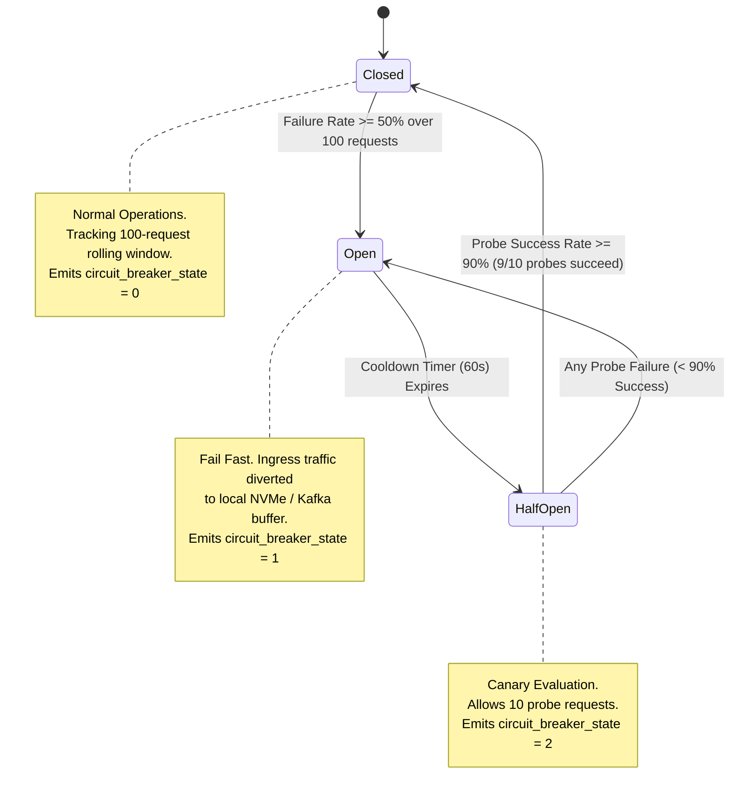
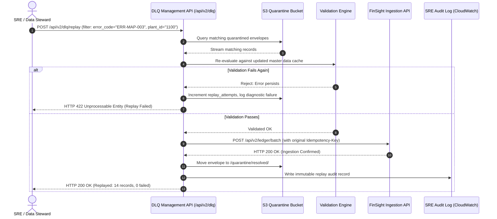

# MERIDIAN MANUFACTURING LTD. | PRODUCTION INTEGRATION BLUEPRINT
**Document Reference:** ZET-MM-D4-PROD-2026-V1  
**Project:** Meridian ERP-to-Analytics Integration (SAP S/4HANA to FinSight 4.2)  
**Classification:** Confidential / Enterprise Production Standard  
**Revision Date:** October 2026  
**Status:** Approved for Production Deployment  

---
# PART 1: DELIVERABLE D4 - ERROR HANDLING & RETRY FRAMEWORK

## 1.1 ERROR CLASSIFICATION TAXONOMY

The integration engine standardizes error handling across all ingest, transform, load, and reconciliation stages using four distinct, mutually exclusive error classes. Each class mandates a deterministic recovery policy to protect upstream SAP RFC work processes, maintain MPLS bandwidth thresholds (max 112.5 Mbps during business hours), and prevent ledger state corruption.

```
                                  ┌────────────────────────┐
                                  │    Pipeline Failure    │
                                  └───────────┬────────────┘
                                              │
                      ┌───────────────────────┴───────────────────────┐
                      │                                               │
             [Operational Root]                             [Semantic / Invariant]
                      │                                               │
          ┌───────────┴───────────┐                       ┌───────────┴───────────┐
          │                       │                       │                       │
    ▼     ▼                 ▼     ▼                 ▼     ▼                 ▼     ▼
┌──────────────────┐┌──────────────────┐┌──────────────────┐┌──────────────────┐
│    TRANSIENT     ││      SYSTEM      ││   DATA QUALITY   ││    PERMANENT     │
├──────────────────┤├──────────────────┤├──────────────────┤├──────────────────┤
│• Network Hiccup  ││• Node Out of Mem ││• Unbalanced GL   ││• 401 Unauthorized│
│• 503 / 429 Rate  ││• EBS Disk Full   ││• Bad GSTIN / PAN ││• Schema Drift    │
│• RFC Pool Busy   ││• Kafka Broker Dwn││• Unmapped CostCtr││• 400 Bad Request │
├──────────────────┤├──────────────────┤├──────────────────┤├──────────────────┤
│ ACTION: Retry    ││ ACTION: Failover ││ ACTION: Isolate  ││ ACTION: Halt &   │
│ with Backoff +   ││ Circuit Breaker  ││ to S3 DLQ; Notify││ Reject Payload;  │
│ Jitter; Spillover││ P1/P2 On-Call    ││ Data Stewards    ││ Notify Architect │
└──────────────────┘└──────────────────┘└──────────────────┘└──────────────────┘
```

### Taxonomy Definitions:
1. **TRANSIENT:** Temporary infrastructure anomalies, network micro-partitions over the 450 Mbps MPLS link, transient gateway throttles (HTTP 429), temporary backpressure, or lock contention in SAP S/4HANA (e.g., table `ACDOCA` enqueue locks).  
   *Resolution Policy:* Safe for automated retry using decorrelated jitter backoff. Maximum 4 retry attempts before transitioning to quarantine.
2. **PERMANENT:** Structural defects in the payload, schema violations, invalid HTTP verbs, malformed JSON/Protocol Buffers, missing mandatory cryptographic signatures, or authentication/authorization rejections (HTTP 401/403, SAP `S_RFC` rejection).  
   *Resolution Policy:* Immediate failure. Retries are strictly prohibited as repeated requests will produce identical failures. Route directly to DLQ with fatal diagnostic tags.
3. **DATA QUALITY (DQ):** Business invariant breaches, reference data absence (e.g., Cost Centre unmapped in `CSKS`, missing entry in `TCURR` exchange rate table), or statutory format failures (e.g., invalid Indian GSTIN checksum).  
   *Resolution Policy:* Non-blocking quarantine. The offending document or line item is isolated into the quarantine storage layer while the remaining batch completes. Triggers workflow ticket to Plant Master Data Stewards.
4. **SYSTEM:** Catastrophic underlying platform failures, host OS out-of-memory (OOM) eviction, worker disk exhaustion, AWS KMS envelope decryption failures, or Kafka storage partition degradation.  
   *Resolution Policy:* Immediate circuit breaking, traffic draining, process fencing, and P1 critical alerting to the SRE Command Center.

---

## 1.2 COMPLETE PRODUCTION ERROR CODE REGISTRY

Every pipeline exception is mapped to a standardized alphanumeric code adhering to the syntax: `ERR-[STAGE]-[SEQUENCE]`.

| Error Code | Canonical Name | Class | HTTP/RFC Equivalent | Retryable | Handling Strategy & Escalation |
| :--- | :--- | :--- | :--- | :---: | :--- |
| **ERR-EXT-001** | SAP RFC Pool Exhaustion | TRANSIENT | RFC_COMMUNICATION_FAILURE (RC=1) | YES | Trigger decorrelated backoff. If active connections = 50, pause polling for 15s. Escalate to P3 if sustained > 5 min. |
| **ERR-EXT-002** | ODP Delta Token Sequence Gap | PERMANENT | RODPS_REPL_EXCEPTION (RC=12) | NO | Halt extraction pipeline for target provider. Prevent out-of-order delta ingestion. Trigger SAP ODP delta rebuild runbook. Escalate to Lead Integration Architect (P2). |
| **ERR-EXT-003** | SAP Enqueue Lock Contention | TRANSIENT | RFC_SYSTEM_FAILURE (TABLE_LOCKED) | YES | Retry with jitter up to 4 attempts. Target SAP background lock release (wait for `RGGBS000` window clearance). If unresolved, divert batch to spillover cache. |
| **ERR-EXT-004** | SAP RFC Authorization Rejected | PERMANENT | RFC_NO_AUTHORIZATION (`S_RFC`) | NO | Terminate session immediately. Log failed authorization object and service user ID. Alert Infosec & SAP Basis via P1/P2 ticket. |
| **ERR-MAP-001** | Unmapped Cost/Profit Center | DATA QUALITY | TRANSFORMATION_LOOKUP_FAILURE | NO (To DLQ) | Isolate record to DLQ quarantine. Lookup against `CSKS`/`CEPC` cache failed. Generate master data ticket assigned to Plant Controller. |
| **ERR-MAP-002** | Fiscal Variant V3 Mapping Failure | DATA QUALITY | DATE_OUT_OF_BOUNDS | NO (To DLQ) | Flag invalid posting date `BUDAT` or period `POPER` (outside 01-16). Route to DLQ with payload snapshot. Batch processing continues for valid items. |
| **ERR-MAP-003** | Invalid GSTIN/PAN Checksum | DATA QUALITY | STATUTORY_VALIDATION_ERROR | NO (To DLQ) | Quarantine line item. Validate against GST 15-character alphanumeric regex and mod-36 checksum. Alert Plant Accounts Payable lead. |
| **ERR-MAP-004** | TCURR Missing Exchange Rate | DATA QUALITY | CURRENCY_CONVERSION_ERROR | NO (To DLQ) | Query missing `KURST='M'` rate for posting date. If unavailable, isolate record to DLQ. Do not apply stale rates > 24 hours without audit override. |
| **ERR-MAP-005** | 3-Way Tax Split Mismatch | DATA QUALITY | TAX_CALCULATION_MISMATCH | NO (To DLQ) | Verify $CGST + SGST = IGST$ equivalent. If rounding variance exceeds $\pm 0.05\text{ INR}$, quarantine record and signal tax compliance queue. |
| **ERR-MAP-006** | Schema Cast / Overflow Error | PERMANENT | DATA_TYPE_CONVERSION_EXCEPTION | NO | Drop to DLQ with stack trace. Decimal precision overflow in Decimal(18,2) or invalid string encoding (UTF-8). Notify Data Integration Team. |
| **ERR-LOAD-001**| FinSight API Rate Limited | TRANSIENT | HTTP 429 Too Many Requests | YES | Respect `Retry-After` response header. Apply exponential backoff. Engage worker concurrency throttle (scale down active threads from 16 to 4). |
| **ERR-LOAD-002**| FinSight Gateway Down | TRANSIENT | HTTP 503 Service Unavailable / 504 | YES | Engage Circuit Breaker. Buffer transformed micro-batches in local Kafka buffer. Failover to secondary ingress if downtime > 60s. |
| **ERR-LOAD-003**| FinSight JWT Token Expired | PERMANENT | HTTP 401 Unauthorized / 403 Forbidden | NO (Auto-Refresh) | Invalidate local token cache. Invoke OAuth 2.0 token endpoint using mTLS client credentials. If refresh fails 2x, trip P1 alert. |
| **ERR-LOAD-004**| Malformed Ingestion Payload | PERMANENT | HTTP 400 Bad Request | NO | Reject batch. Write malformed JSON/Protobuf payload directly to S3 Dead Letter bucket. Alert Integration Engineer. |
| **ERR-LOAD-005**| Idempotency Key Conflict | PERMANENT | HTTP 409 Conflict | NO | Verify existing transaction status via `GET /api/v2/ledger/status/{idempotency_key}`. If prior batch committed, mark as SUCCESS (skip duplicate). |
| **ERR-RECON-001**| Dual-Entry GL Balance Breach | DATA QUALITY | FINANCIAL_INTEGRITY_BREACH | NO (HALT) | **CRITICAL P1:** Balance variance $\sum(\text{Debits}) - \sum(\text{Credits}) \neq 0.00\text{ INR}$. Immediate pipeline freeze. Notify Head of Finance & SRE Lead. |
| **ERR-RECON-002**| Batch Count Discrepancy | DATA QUALITY | RECONCILIATION_COUNT_MISMATCH | NO (HALT) | Check equation: $Extracted \neq Loaded + Skipped + Quarantined$. Pause delta commit token. Trigger audit reconciliation scan. |
| **ERR-RECON-003**| Checksum Hash Mismatch | DATA QUALITY | CRYPTOGRAPHIC_INTEGRITY_BREACH | NO (HALT) | Ingested SHA-256 payload digest differs from SAP source hash. Quarantine batch. Guard against in-flight network corruption. |
| **ERR-SYS-001** | Worker Node Resource Saturation | SYSTEM | OS_RESOURCE_EXHAUSTION (OOM/CPU) | NO | Kubernetes liveness/readiness probe failure. Evict pod, spin up replacement on secondary node, auto-scale worker pool via HPA. |
| **ERR-SYS-002** | Kafka Broker / Ingress Partition | SYSTEM | BROKER_UNREACHABLE_EXCEPTION | YES (to Buffer) | Fallback to local NVMe disk buffer queue. Reroute traffic away from degraded AZ in `ap-south-1`. Alert SRE on-call immediately (P1). |

---

## 1.3 RESILIENCE & CIRCUIT BREAKER MECHANICS

### 1.3.1 Decorrelated Exponential Backoff with Jitter
To prevent "thundering herd" spikes against both the on-premise SAP Gateway and the cloud FinSight Ingestion API, all transient retries utilize **Decorrelated Exponential Backoff with Full Jitter**.

#### Mathematical Formulation:
Let $c$ be the maximum wait cap, $b$ the base wait time, and $a$ the current retry attempt ($a \in \{1, 2, 3, 4\}$):
$$\text{wait}_a = \min\left(c, \text{Uniform}\left(b, b \times 2^a\right)\right)$$

Where:
* **Base ($b$):** $2.0\text{ seconds}$
* **Multiplier:** $2.0$
* **Cap ($c$):** $60.0\text{ seconds}$
* **Max Attempts ($N_{max}$):** $4\text{ attempts}$

#### Quantitative Retry Sequence Table:
| Attempt ($a$) | Minimum Wait ($\text{sec}$) | Maximum Wait Calculation | Actual Cap Range ($\text{sec}$) | Expected Mean Wait ($\text{sec}$) | Cumulative Mean Wait ($\text{sec}$) |
| :---: | :---: | :---: | :---: | :---: | :---: |
| **1** | $2.0$ | $2.0 \times 2^1 = 4.0$ | $[2.0, 4.0]$ | $3.0$ | $3.0$ |
| **2** | $2.0$ | $2.0 \times 2^2 = 8.0$ | $[2.0, 8.0]$ | $5.0$ | $8.0$ |
| **3** | $2.0$ | $2.0 \times 2^3 = 16.0$ | $[2.0, 16.0]$ | $9.0$ | $17.0$ |
| **4** | $2.0$ | $2.0 \times 2^4 = 32.0$ | $[2.0, 32.0]$ | $17.0$ | $34.0$ |
| **Exhausted** | - | - | - | - | **Route to DLQ / Raise ERR-LOAD-002** |

#### Implementation Reference (Production Python 3.11):
```python
import random
import time
import logging
from typing import Callable, Any

logger = logging.getLogger("meridian.resilience")

BASE_BACKOFF_SEC = 2.0
CAP_BACKOFF_SEC = 60.0
MAX_ATTEMPTS = 4

def execute_with_jitter_backoff(operation: Callable[[], Any], operation_name: str) -> Any:
    """
    Executes a callable utilizing Decorrelated Exponential Backoff with Jitter.
    Enforces Meridian SRE resilience constraints.
    """
    attempt = 1
    while attempt <= MAX_ATTEMPTS:
        try:
            return operation()
        except TransientException as exc:
            if attempt == MAX_ATTEMPTS:
                logger.error(
                    f"Exhausted all {MAX_ATTEMPTS} attempts for operation '{operation_name}'. "
                    f"Routing to DLQ. Last error: {str(exc)}",
                    extra={"error_code": exc.error_code, "attempt": attempt}
                )
                raise
            
            upper_bound = min(CAP_BACKOFF_SEC, BASE_BACKOFF_SEC * (2 ** attempt))
            sleep_duration = random.uniform(BASE_BACKOFF_SEC, upper_bound)
            
            logger.warning(
                f"Transient failure during '{operation_name}' (attempt {attempt}/{MAX_ATTEMPTS}). "
                f"Backing off for {sleep_duration:.3f}s. Error: {str(exc)}",
                extra={"retry_wait_sec": sleep_duration, "attempt": attempt}
            )
            time.sleep(sleep_duration)
            attempt += 1
```

---

### 1.3.2 Circuit Breaker State Machine

To shield FinSight and SAP Gateway during catastrophic outages, the pipeline wraps all egress clients in a strict three-state Circuit Breaker.



#### Operational State Transition Specifications:
1. **CLOSED (State Code: 0):**
   * All requests pass through to the target service.
   * Execution metrics are tracked in a sliding window of **100 consecutive requests**.
   * *Trip Condition:* If $\ge 50\%$ (50 out of 100) return `TRANSIENT` or `SYSTEM` errors (`ERR-LOAD-001`, `ERR-LOAD-002`, `ERR-EXT-001`, `ERR-SYS-002`), the circuit breaker trips immediately to **OPEN**.
2. **OPEN (State Code: 1):**
   * All outbound requests are intercepted and failed fast without touching the target network interface.
   * Incoming messages from SAP are buffered directly into high-durability Kafka topics (`meridian.backpressure.buffer.v1`) to prevent upstream SAP RFC work process blocking.
   * *Reset Timer:* A hard sleep of **60.0 seconds** is enforced. After 60 seconds, the breaker transitions to **HALF-OPEN**.
3. **HALF-OPEN (State Code: 2):**
   * The breaker permits exactly **10 canary probe requests** through to the target endpoint.
   * *Success Criterion:* If $\ge 90\%$ (at least 9 out of 10) canary probes succeed, the breaker transitions back to **CLOSED**, resets the rolling error window, and restores normal stream processing.
   * *Failure Criterion:* If $> 1$ probe fails ($< 90\%$ success rate), the breaker immediately trips back to **OPEN** for another 60-second cooldown cycle.

---

## 1.4 DEAD LETTER QUEUE (DLQ) ARCHITECTURE & REPLAY PROTOCOL

### 1.4.1 Storage & Retention Architecture
Messages that fail due to `PERMANENT` errors, `DATA QUALITY` violations, or exhausted retries are diverted to the enterprise Dead Letter Queue.

* **Primary Storage:** Dedicated Amazon S3 Bucket: `s3://meridian-prod-dlq-ap-south-1/quarantine/`
* **Encryption Standard:** AWS KMS Customer-Managed Key (CMK) with AES-256 GCM envelope encryption (`arn:aws:kms:ap-south-1:112233445566:key/meridian-dlq-cmk`).
* **Enforced Retention:** **14 Days** active lifecycle in S3 Standard.
* **Archival Lifecycle Rule:** After 14 days, automated S3 Lifecycle transitions unpurged quarantine payloads to **S3 Glacier Flexible Retrieval** for **7 years** to satisfy the mandatory financial audit trail requirements under Section 128 of the Indian Companies Act 2013.
* **Tamper Protection:** S3 Object Lock in **Compliance Mode** enabled; prevents deletion or alteration by any IAM identity, including AWS root.

### 1.4.2 Quarantine Envelope Schema
Every quarantined message is encapsulated in an immutable diagnostic envelope:

```json
{
  "$schema": "https://meridian.com/schemas/dlq-envelope-v1.json",
  "dlq_message_id": "dlq-7a1b-4f9c-9821-20261004110001",
  "correlation_id": "c928e9e2-6a2d-4c44-a17e-734689b552f9",
  "batch_id": "BATCH-20261004-1100-01",
  "plant_id": "1100",
  "source_entity": "ACDOCA",
  "sap_document_id": "0100049281",
  "fiscal_year": "2026",
  "error_code": "ERR-MAP-003",
  "error_class": "DATA_QUALITY",
  "error_description": "GSTIN checksum verification failed: 27AABCM8892A1Z1 mismatch for Plant 1100",
  "quarantine_timestamp": "2026-10-04T06:38:12.412Z",
  "retry_count": 4,
  "payload_sha256": "e3b0c44298fc1c149afbf4c8996fb92427ae41e4649b934ca495991b7852b855",
  "remediation_status": "PENDING_REVIEW",
  "raw_payload": {
    "RCLNT": "100",
    "RLDNR": "0L",
    "RBUKRS": "1000",
    "GJAHR": "2026",
    "BELNR": "0100049281",
    "DOCLN": "000001",
    "PRCTR": "PC1100",
    "KOSTL": "CC1100-ENG",
    "BUDAT": "20261004",
    "BLDAT": "20261004",
    "WAERS": "INR",
    "HSL": 482500.00,
    "SHKZG": "S",
    "GSTIN": "27AABCM8892A1Z1"
  }
}
```

### 1.4.3 Operational Replay Protocol & Management APIs

To eliminate manual database tampering, the SRE team operates an automated, idempotent Replay Engine exposed via secure REST endpoints requiring role `ROLE_MERIDIAN_SRE_ADMIN`.



#### DLQ API Endpoints:
* `GET /api/v2/dlq/messages`: Query quarantine backlog. Supports filters: `plant_id`, `error_code`, `date_from`, `date_to`, `status`.
* `GET /api/v2/dlq/messages/{dlq_message_id}`: Fetch complete diagnostic envelope and raw payload.
* `POST /api/v2/dlq/replay`: Execute automated batch replay. Payload parameters:
  ```json
  {
    "filter": {
      "plant_id": "1100",
      "error_code": "ERR-MAP-003",
      "quarantine_date": "2026-10-04"
    },
    "dry_run": false,
    "force_revalidation": true,
    "audit_justification": "GSTIN master table updated with correct state registration code for Pune Chakan Plant."
  }
  ```
* `PATCH /api/v2/dlq/messages/{dlq_message_id}`: Apply certified in-flight mutation (requires two-man rule digital signature from Plant Controller and SRE).

---
