# MERIDIAN MANUFACTURING LTD. | PRODUCTION INTEGRATION BLUEPRINT
**Document Reference:** ZET-MM-D8-RUNBOOK-2026-V1  
**Project:** Meridian ERP-to-Analytics Integration (SAP S/4HANA to FinSight 4.2)  
**Classification:** Confidential / Enterprise Production Standard  
**Revision Date:** October 2026  
**Status:** Approved for Production Deployment  

---
# MODULE 2: DELIVERABLE D8 - DEPLOYMENT RUNBOOK & ROLLBACK PROCEDURE

## 2.1 FIFTEEN (15) PRE-DEPLOYMENT VERIFICATION CHECKLIST

Prior to initiating production cutover, the Deployment Lead and SAP Basis Lead must verify all 15 prerequisites. Every item requires a formal sign-off timestamp.

| Item # | Verification Scope | Verification Method / Command | Required State | Owner | Sign-off |
| :---: | :--- | :--- | :--- | :---: | :---: |
| **01** | Change Advisory Board (CAB) Approval | Inspect ServiceNow RFC ticket `CR-2026-10-8842` | Status: APPROVED / CAB Sign-off complete | FDE Lead | [x] PASSED |
| **02** | SAP Transport Requests (TRs) | Check SAP STMS import log for `P40K902140`, `P40K902145` | Status: RC=0 (All objects imported cleanly) | SAP Basis | [x] PASSED |
| **03** | SAP RFC Pool Reservation | Execute SAP t-code `SM59` & check connection pool quota | 50 RFC connections dedicated to `Z_FINSIGHT_SVC` | SAP Basis | [x] PASSED |
| **04** | SAP ODP Delta Queues | Inspect t-code `ODQMON` for provider `ZCDS_ACDOCA_DELTA` | Queue status: Active / Initialized / Empty | SAP Basis | [x] PASSED |
| **05** | MPLS Link Health & Bandwidth | Query SD-WAN orchestrator bandwidth metrics | Link: Active (450 Mbps), Latency $< 24\text{ms}$ | Network Lead | [x] PASSED |
| **06** | AWS VPC Peering & Transit Gateway | Execute ping and mTLS handshake across transit gateway | Latency $< 26\text{ms}$, 0% packet loss | Cloud Sec | [x] PASSED |
| **07** | AWS KMS Encryption Keys | `aws kms describe-key --key-id meridian-dlq-cmk` | Status: Enabled, KeyRotation: Enabled | Cloud Sec | [x] PASSED |
| **08** | S3 DLQ Bucket & Compliance Lock | `aws s3api get-object-lock-configuration --bucket meridian-prod-dlq` | Lock Mode: COMPLIANCE, Retention: 14 Days | Cloud Sec | [x] PASSED |
| **09** | Kafka Production Cluster Health | `kafka-cluster.sh --bootstrap-server kafka:9092 describe` | 3 brokers online, 0 under-replicated partitions | SRE Lead | [x] PASSED |
| **10** | FinSight Ingestion API Availability| `curl -k -I https://ingress.finsight.meridian.internal/healthz` | HTTP 200 OK, Version: 4.2.1-PROD | Platform Eng| [x] PASSED |
| **11** | OAuth 2.0 Credentials Active | Test token acquisition via `/oauth/v2/token` | HTTP 200 OK, Valid JWT emitted | Platform Eng| [x] PASSED |
| **12** | Redis Master Data Cache | `redis-cli -h redis-prod.meridian-etl ping` | Response: PONG, Memory $< 20\%$ | SRE Lead | [x] PASSED |
| **13** | Database Schema Migration Status | Run Liquibase migration check `liquibase status` | All 42 database change-sets applied | Data Lead | [x] PASSED |
| **14** | Production Backup Verification | Snapshot RDS PostgreSQL and on-premise config state | AWS EBS & RDS Snapshots completed cleanly | SRE Lead | [x] PASSED |
| **15** | On-Call PagerDuty Escalation Active | Test PagerDuty integration bridge `#sre-oncall` | Test alert acknowledged by primary on-call | SRE Lead | [x] PASSED |

---

## 2.2 CHRONOLOGICAL CUTOVER EXECUTION PLAN

The cutover executes during the approved maintenance window outside the SAP batch job `RGGBS000` (`01:00 - 04:30 IST`). Execution starts at **T-minus 6 hours** and concludes at **T+2 hours**.

```mermaid
gantt
    title Meridian ERP-to-Analytics Production Cutover Window
    dateFormat HH:mm
    axisFormat %H:%M
    section Pre-Cutover
    Pre-Deployment Checks (T-6h to T-3h)       :00:00, 180m
    Freeze Upstream Non-Essential Jobs (T-3h)  :03:00, 60m
    section Cutover
    Final Delta Baseline Snapshot (T-1h)       :04:00, 60m
    Deploy Kubernetes Infrastructure (T-0)     :05:00, 30m
    Kafka Topics & Secrets Activation          :05:30, 15m
    Startup Pipeline Consumer Groups           :05:45, 15m
    section Post-Cutover
    Execute 10 Smoke Verification Checks (T+15m):06:00, 30m
    Initial 30-min Delta Sync Run (T+45m)      :06:30, 30m
    Reconciliation Sign-Off & CAB Close (T+2h) :07:00, 60m
```



### Detailed Step-by-Step Procedure with Production CLI Commands:

#### Phase 1: Pre-Cutover & Freezes (T-6h to T-1h)
1. **[T-360m]** Convene Bridge: Open Microsoft Teams War Room with all leads (FDE, Basis, SRE, Infosec).
2. **[T-180m]** Verify 15-point checklist sign-off.
3. **[T-60m] Baseline SAP ODP High-Water Mark:**
   ```bash
   # Capture current extraction pointer in SAP
   python3 /opt/meridian/scripts/sap_odp_snapshot.py \
       --provider ZCDS_ACDOCA_DELTA \
       --output /var/log/meridian/cutover_baseline_pointer.json
   ```

#### Phase 2: Deployment Execution (T-0 to T+30m)
4. **[T-00m] Provision Production Kafka Topics with Retention Policies:**
   ```bash
   # Create Kafka topics with 3x replication and compaction
   kafka-topics.sh --bootstrap-server kafka.meridian-prod.internal:9092 --create \
       --topic meridian.sap.acdoca.raw.v1 \
       --partitions 12 --replication-factor 3 \
       --config min.insync.replicas=2 --config retention.ms=604800000

   kafka-topics.sh --bootstrap-server kafka.meridian-prod.internal:9092 --create \
       --topic meridian.backpressure.buffer.v1 \
       --partitions 6 --replication-factor 3 \
       --config min.insync.replicas=2 --config retention.ms=1209600000

   kafka-topics.sh --bootstrap-server kafka.meridian-prod.internal:9092 --create \
       --topic meridian.dlq.quarantine.v1 \
       --partitions 3 --replication-factor 3 \
       --config min.insync.replicas=2 --config retention.ms=1209600000
   ```

5. **[T+10m] Deploy Kubernetes Microservices via Helm:**
   ```bash
   # Deploy production release v4.2.0 across meridian-etl namespace
   helm upgrade --install meridian-pipeline ./helm/meridian-etl \
       --namespace meridian-etl \
       --values ./helm/meridian-etl/values-production.yaml \
       --set image.tag="v4.2.0-RELEASE" \
       --set config.sapRfcPoolSize=50 \
       --set config.mplsBandwidthCapMbps=112.5 \
       --atomic --timeout 300s
   ```

6. **[T+20m] Seed Master Data Cache in Redis:**
   ```bash
   # Warm up Cost Centre and Profit Centre caches from SAP master tables
   kubectl exec -it deployment/meridian-transformer -n meridian-etl -- \
       python3 -m meridian.tools.warm_master_cache --all-plants --controlling-area IN01
   ```

---

## 2.3 TEN (10) POST-DEPLOYMENT SMOKE VERIFICATION CHECKS

Execute these 10 verification steps within the first 15 minutes of deployment:

```bash
# 1. Verify all worker pods are Running and Ready (0 restarts)
kubectl get pods -n meridian-etl -l app.kubernetes.io/part-of=meridian-pipeline

# 2. Check RFC Extractor gateway connectivity to Pune SAP Data Centre
kubectl exec -it deployment/meridian-extractor -n meridian-etl -- \
    python3 -c "from meridian.sap import test_rfc_ping; print(test_rfc_ping())"

# 3. Verify FinSight API mTLS and OAuth Token Generation
curl -s --cert /etc/ssl/certs/meridian-client.crt \
     --key /etc/ssl/private/meridian-client.key \
     https://api.finsight.meridian.internal/api/v2/healthz | jq .

# 4. Check Kafka Consumer Group registration and partition assignment
kafka-consumer-groups.sh --bootstrap-server kafka.meridian-prod.internal:9092 \
    --describe --group meridian-fin-ingest

# 5. Validate S3 DLQ Bucket Write and KMS Encryption
aws s3 cp /etc/hosts s3://meridian-prod-dlq-ap-south-1/quarantine/smoke_test.txt \
    --sse aws:kms --sse-kms-key-id arn:aws:kms:ap-south-1:112233445566:key/meridian-dlq-cmk
aws s3 rm s3://meridian-prod-dlq-ap-south-1/quarantine/smoke_test.txt

# 6. Verify Prometheus metrics scraping endpoint is active
curl -s http://meridian-pipeline-worker.meridian-etl:9090/metrics | grep "pipeline_records_processed_total"

# 7. Confirm Circuit Breaker initial state is CLOSED (state = 0)
curl -s http://meridian-pipeline-worker.meridian-etl:9090/metrics | grep "circuit_breaker_state.*0"

# 8. Trigger synthetic canary transaction across Plant 1100
curl -X POST http://meridian-pipeline-worker.meridian-etl:8080/api/v1/test/canary \
    -H "Content-Type: application/json" -d '{"plant_id":"1100","dry_run":false}'

# 9. Verify Grafana Dashboard MON-001 (Pipeline Health) is displaying Green
curl -s -u admin:${GRAFANA_API_KEY} "https://grafana.meridian.internal/api/dashboards/uid/meridian-erp-sre-overview" | jq .dashboard.panels[0].title

# 10. Confirm zero error logs across last 10 minutes in CloudWatch
aws logs filter-log-events --log-group-name /meridian/pipeline/prod \
    --filter-pattern "ERROR" --start-time $(($(date +%s) - 600))000
```

---

## 2.4 ROLLBACK PROTOCOL & DECISION MATRIX

### 2.4.1 Rollback Decision Matrix & Trigger Criteria
A formal Rollback Review is triggered if any of the following boundary violations occur during the 120-minute post-deployment monitoring window.

```
                                  ┌───────────────────────────┐
                                  │ Post-Cutover Monitoring   │
                                  └─────────────┬─────────────┘
                                                │
                         Any Threshold Breached within 120 min?
                                                │
                 ┌──────────────────────────────┴──────────────────────────────┐
                 │                                                             │
                 ▼ YES                                                         ▼ NO
   ┌───────────────────────────┐                                 ┌───────────────────────────┐
   │ Check Trigger Matrix:     │                                 │ Formal Cutover Sign-Off   │
   │ 1. Recon Break > 0.00 INR │                                 │ CAB RFC Ticket Closed     │
   │ 2. Error Rate > 5.0%      │                                 │ Operations Normal         │
   │ 3. SLA Latency > 45 mins  │                                 └───────────────────────────┘
   │ 4. RFC Pool Exhaustion    │
   └─────────────┬─────────────┘
                 │
                 ▼
   ┌───────────────────────────┐
   │ Emergency 15-Minute       │
   │ Rollback Decision Council │
   │ (CFO, VP IT, FDE Lead)    │
   └─────────────┬─────────────┘
                 │
                 ├─────────────────────────────┐
                 ▼ ABORT                       ▼ PROCEED
   ┌───────────────────────────┐ ┌───────────────────────────┐
   │ Execute Rollback Script   │ │ Authorize In-Flight Patch │
   │ Drain Kafka & Stop Pods   │ │ (SRE Hotfix Protocol)     │
   │ Restore SAP Delta Token   │ └───────────────────────────┘
   └───────────────────────────┘
```

| Trigger Code | Trigger Condition Metric | Evaluation Window | Immediate Action |
| :---: | :--- | :---: | :--- |
| **TRG-RB-001** | Financial Reconciliation Variance $\ne 0.00\text{ INR}$ | 1 Batch | **Automatic Abort.** Emergency pipeline freeze. Convene rollback council. |
| **TRG-RB-002** | Pipeline Error Rate $> 5.0\%$ of total records | 10 Minutes | **Automatic Abort.** Divert ingress to buffer. Evaluate root cause. |
| **TRG-RB-003** | End-to-End Ingestion Latency $> 45\text{ minutes}$ | 30 Minutes | High risk of SLA breach. Throttle extractor concurrency. |
| **TRG-RB-004** | SAP RFC Pool Exhaustion ($> 48$ active) | 5 Minutes | Basis intervention. If unresolvable in 10 mins, initiate rollback. |
| **TRG-RB-005** | MPLS Link Bandwidth $> 112.5\text{ Mbps}$ sustained | 5 Minutes | Network shaper auto-throttles. If link degrades, abort cutover. |

* **Maximum Rollback Decision Window:** **15 Minutes** from initial trigger alert.
* **Authorizing Authority:** Unanimous consent required between Rajesh Venkataraman (VP IT), Priya Deshmukh (Basis Lead), and FDE Lead.

### 2.4.2 Step-by-Step Rollback Execution Procedure
```bash
#!/usr/bin/env bash
# ==============================================================================
# SRE PRODUCTION ROLLBACK EXECUTION SCRIPT
# EXECUTION TIME: < 8 MINUTES
# ==============================================================================
set -euo pipefail

echo "[ROLLBACK INITIATED] Halting production pipeline and reverting to baseline..."

# 1. Scale all Kubernetes ingestion and transformation pods to 0
kubectl scale deployment meridian-extractor --replicas=0 -n meridian-etl
kubectl scale deployment meridian-transformer --replicas=0 -n meridian-etl
kubectl scale deployment meridian-loader --replicas=0 -n meridian-etl
kubectl scale deployment meridian-reconciler --replicas=0 -n meridian-etl

# 2. Reset SAP ODP Delta Queue pointer to pre-cutover baseline snapshot
python3 /opt/meridian/scripts/sap_odp_rollback.py \
    --provider ZCDS_ACDOCA_DELTA \
    --restore-pointer /var/log/meridian/cutover_baseline_pointer.json

# 3. Purge uncommitted in-flight messages from Kafka processing topics
kafka-consumer-groups.sh --bootstrap-server kafka.meridian-prod.internal:9092 \
    --group meridian-fin-ingest --reset-offsets --to-offset 0 --execute \
    --topic meridian.sap.acdoca.raw.v1

# 4. Rollback Helm release to previous stable revision
helm rollback meridian-pipeline -n meridian-etl

# 5. Revoke transient OAuth2 production tokens
curl -X POST https://api.finsight.meridian.internal/oauth/v2/revoke \
    -d "client_id=${PROD_CLIENT_ID}&client_secret=${PROD_CLIENT_SECRET}"

# 6. Notify SRE, IT VP, and CFO via PagerDuty and Slack
curl -X POST -H 'Content-type: application/json' \
    --data '{"text":"⚠️ *ROLLBACK COMPLETE:* Production integration reverted to baseline state. SAP delta queues intact. Incident post-mortem room open."}' \
    "${SLACK_INCIDENTS_WEBHOOK_URL}"

echo "[SUCCESS] Rollback completed. Zero data loss verified."
```

---
